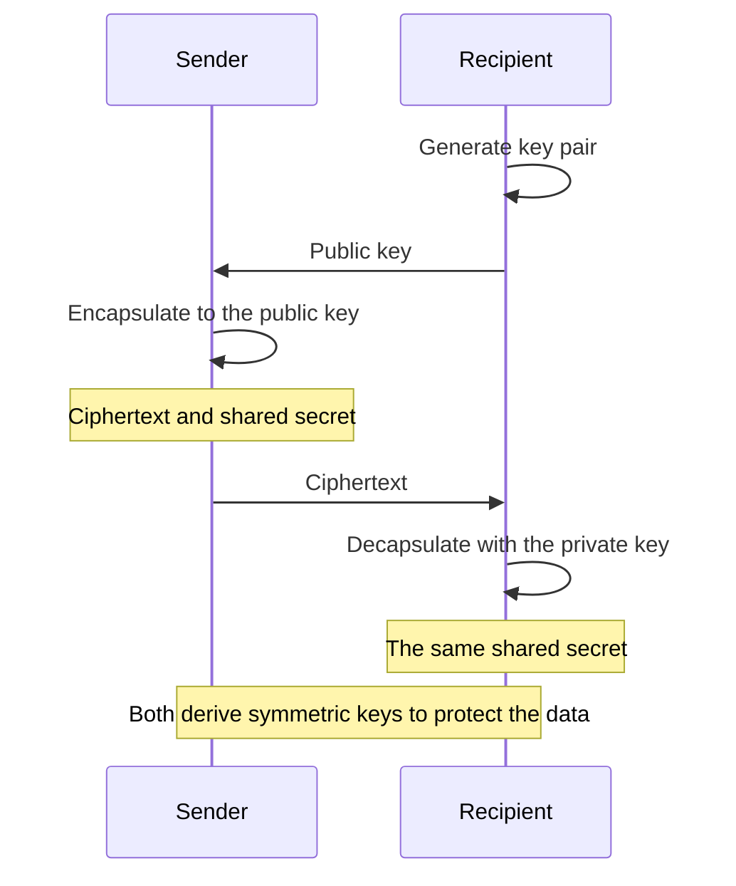

**Question this answers:** what does ML-KEM actually do, and why does replacing Diffie–Hellman with it change protocols? **Background:** [Public-key cryptography](/learn/public-key-cryptography/), [What the keys actually do](/learn/explainers/keys/).

## The mechanism

[NIST IR 8547](https://doi.org/10.6028/NIST.IR.8547) (October 2026, §2.1.2) describes a key-encapsulation mechanism (KEM) as a particular type of key-establishment scheme that two parties can use to establish a shared secret key over a public channel. [SP 800-227](https://csrc.nist.gov/pubs/sp/800/227/final) (September 2025) gives NIST's recommendations for using KEMs securely.

A KEM has three operations:

1. **Key generation.** The recipient creates a key pair and publishes (or sends) the public key.
2. **Encapsulation.** The sender runs encapsulation on the recipient's public key. It outputs a **shared secret** and a **ciphertext**. The sender keeps the secret and sends the ciphertext.
3. **Decapsulation.** The recipient runs decapsulation on the ciphertext with its private key and gets the same shared secret.

## Not bulk encryption

Unlike public-key encryption, a KEM does not take the application's message as input. The ciphertext only carries what the recipient needs to recover the shared secret. The data itself is then protected with symmetric cryptography keyed from that secret. NIST IR 8547 (§3.2.1) notes that ML-KEM's output is already a shared secret key that does not need further key derivation, although protocols usually derive several keys from it.

## How it differs from what it replaces

| | Diffie–Hellman (key agreement) | RSA key transport | KEM (ML-KEM) |
| --- | --- | --- | --- |
| Who needs a key pair | Both parties | Recipient | Recipient |
| Who determines the secret | Both, jointly | Sender chooses it | Produced by encapsulation |
| Messages | Each side sends a public value | Sender sends an encrypted secret | Recipient sends a public key; sender sends a ciphertext |
| Quantum status | Vulnerable to Shor | Vulnerable to Shor | Designed to resist known quantum attacks |

That shape change is why protocols cannot simply swap an algorithm identifier. NIST IR 8547 (§2.2.1) notes that some protocols need more significant changes because post-quantum algorithms have larger sizes or different interfaces. In TLS 1.3 the fit is fairly natural: the client sends a public key in its first message and the server replies with the ciphertext, as [What changes in a TLS connection](/learn/explainers/tls/) shows.

## Combining two KEMs

A hybrid key exchange runs a classical exchange and a KEM side by side and combines their outputs. NIST IR 8547 (§3.2.1) describes the generic method NIST allows: concatenate the two shared secrets and pass the result through an approved key-derivation function, with the order of the inputs fixed by the protocol. The aim is that the derived keys stay secure if at least one component is secure. NIST refers to SP 800-227 for guidance on these "key combiners". [Hybrid cryptography](/learn/hybrid/) covers when authorities recommend it.

## Sources

- NIST, Module-Lattice-Based Key-Encapsulation Mechanism Standard, FIPS 203, 13 August 2024. [FIPS 203](https://csrc.nist.gov/pubs/fips/203/final)
- NIST, Recommendations for Key-Encapsulation Mechanisms, SP 800-227, September 2025. [SP 800-227](https://csrc.nist.gov/pubs/sp/800/227/final)
- NIST, Transition to Post-Quantum Cryptography Standards, NIST IR 8547, October 2026 (§2.1.2, §2.2.1, §3.2.1). [NIST IR 8547](https://doi.org/10.6028/NIST.IR.8547)

## Related pages

- [Post-quantum algorithms](/learn/algorithms/)
- [Hybrid cryptography](/learn/hybrid/)
- [What changes in a TLS connection](/learn/explainers/tls/)
