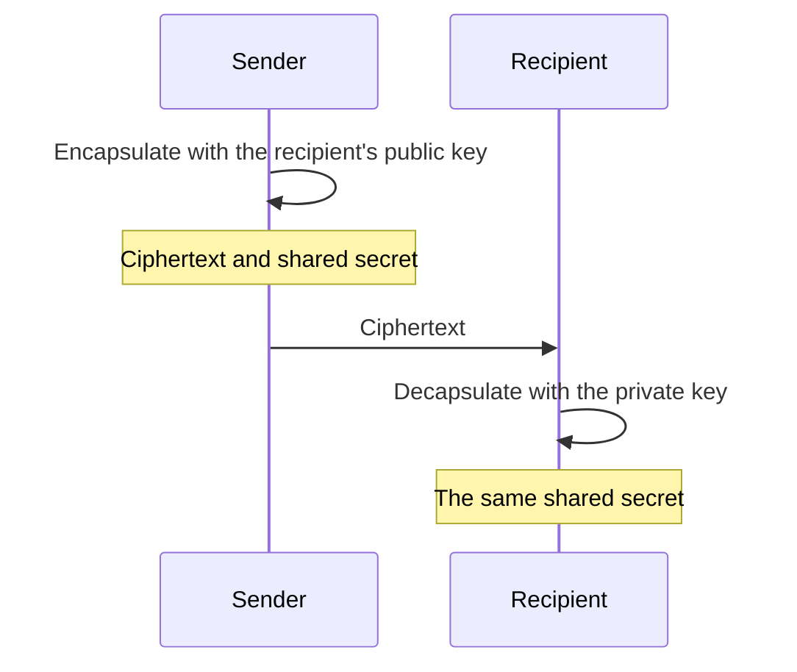

Unlike public-key encryption, a key-encapsulation mechanism does not take the application's message as input. It establishes a secret that the parties can use to protect that message with symmetric cryptography.

The sender encapsulates to the recipient's public key, producing a ciphertext and a shared secret. The recipient decapsulates the ciphertext with the matching private key to derive the same secret. A protocol such as TLS can then derive symmetric keys from that secret to protect the bulk of the traffic.

The figure shows that exchange between two parties.

## Sources

- NIST, Module-Lattice-Based Key-Encapsulation Mechanism Standard, FIPS 203, August 2024. [FIPS 203](https://csrc.nist.gov/pubs/fips/203/final)
- NIST, Transition to Post-Quantum Cryptography Standards, NIST IR 8547, October 2026. [NIST IR 8547](https://doi.org/10.6028/NIST.IR.8547)

## Related pages

- [Algorithms](/learn/algorithms/)
- [What changes in a TLS connection](/learn/explainers/tls/)
