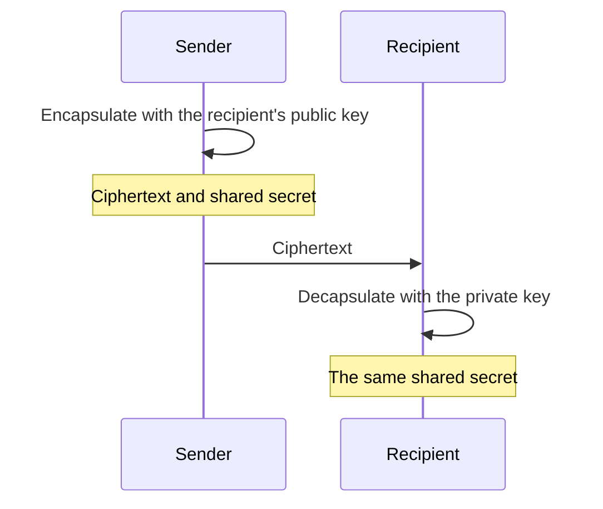

What does a key-encapsulation mechanism produce, and why is that not bulk encryption?

[Algorithms](/learn/algorithms/) describes encapsulation and decapsulation. A KEM produces a shared secret, and it does not carry the page, the file, or the health record.

One party encapsulates with the other's public key and produces a ciphertext and a shared secret. The other decapsulates with the private key and recovers the same secret. A protocol such as TLS then derives symmetric keys from that secret, and those keys protect the bulk of the traffic.

The figure shows that exchange between two parties.

Encapsulation produces a ciphertext and a shared secret. Decapsulation recovers the same secret, and neither step carries the page, the file, or the health record.

That is the same distinction as [Algorithms](/learn/algorithms/). From here, read [What changes in a TLS connection](/learn/explainers/tls/).

## Sources

- NIST, FIPS 203, Module-Lattice-Based Key-Encapsulation Mechanism, for ML-KEM. [FIPS 203](https://csrc.nist.gov/pubs/fips/203/final)
- NIST IR 8547, Transition to Post-Quantum Cryptography Standards, October 2026, for that pattern of use. [NIST IR 8547](https://doi.org/10.6028/NIST.IR.8547)
