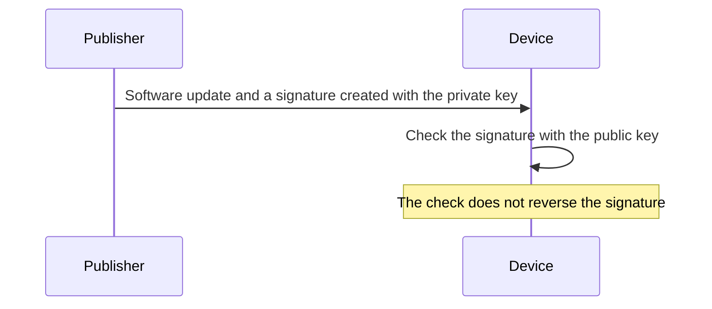

Which job does the public key do, and which job does the private key do?

[Public-key cryptography](/learn/public-key-cryptography/) explains that the public and private keys perform distinct jobs. The table below sets those jobs side by side:

| Scheme or job | Public-key role | Private-key role |
| --- | --- | --- |
| Diffie–Hellman key establishment | Shared with the other party | Combined with the other party's public value to derive a shared secret |
| KEM key establishment | Used by the sender to create a ciphertext and shared secret | Used by the recipient to derive the same shared secret from the ciphertext |
| Classical public-key encryption, where used | Encrypts data | Decrypts data |
| Digital signatures | Verifies the signature against the message | Creates the signature |

Diffie–Hellman uses both parties' key pairs to derive the same secret; it is not a one-way “public key creates, private key recovers” exchange. The KEM row shows the ML-KEM pattern. Key establishment does not encrypt the page, file, or message that an application sends. FIPS 203 standardises key establishment, while FIPS 204 and FIPS 205 standardise digital signatures.

A web session uses key establishment, while a device can use signature verification to check a software update.

The figure follows that software update. The publisher signs it with the private key, and the device checks it with the public key.

That is the same distinction as [Public-key cryptography](/learn/public-key-cryptography/). From here, read [What a quantum computer changes](/learn/explainers/quantum-computers/).

## Sources

- NIST, Transition to Post-Quantum Cryptography Standards, NIST IR 8547, October 2026, for the distinction between key-establishment schemes and signature algorithms in the transition. [NIST IR 8547](https://doi.org/10.6028/NIST.IR.8547)
- NIST, Recommendation for Pair-Wise Key-Establishment Schemes Using Discrete Logarithm Cryptography, SP 800-56A Rev. 3, April 2018. [SP 800-56A Rev. 3](https://csrc.nist.gov/pubs/sp/800/56/a/r3/final)
- NIST, Module-Lattice-Based Key-Encapsulation Mechanism Standard, FIPS 203, August 2024. [FIPS 203](https://csrc.nist.gov/pubs/fips/203/final)
- NIST, Module-Lattice-Based Digital Signature Standard, FIPS 204, August 2024. [FIPS 204](https://csrc.nist.gov/pubs/fips/204/final)
- NIST, Stateless Hash-Based Digital Signature Standard, FIPS 205, August 2024. [FIPS 205](https://csrc.nist.gov/pubs/fips/205/final)
- IETF, PKCS #1: RSA Cryptography Specifications Version 2.2, RFC 8017, November 2016. [RFC 8017](https://www.rfc-editor.org/rfc/rfc8017)
