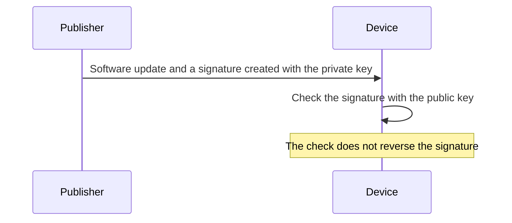

Which job does the public key do, and which job does the private key do?

You have read [Public-key cryptography](/learn/public-key-cryptography/). The further distinction is which key does which job.

**Handbook explanation:**

| Job | What the public key does | What the private key does |
| --- | --- | --- |
| Key establishment | Used to create a shared secret | Recovers that secret |
| Encryption | Encrypts | Decrypts |
| Signing | Checks the signature | Creates the signature |
| Verification | The check itself | Does not reverse the signature |

The encryption row describes that classical job. FIPS 203, FIPS 204, and FIPS 205 do not standardise public-key encryption.

An unnamed web session uses key establishment. An unnamed software update uses signing and verification. The jobs above do not depend on a named algorithm.

The figure shows that software update. The publisher signs it with the private key, and the device checks it with the public key.

The public key is used to create a shared secret, and the private key recovers it. The private key creates a signature, and the public key checks it. Checking a signature does not reverse it.

This distinction continues from [Public-key cryptography](/learn/public-key-cryptography/).

Continue with [What a quantum computer changes](/learn/explainers/quantum-computers/).

## Sources

- NIST, Transition to Post-Quantum Cryptography Standards (NIST IR 8547), October 2026, for the public-key jobs that report names. [NIST IR 8547](https://doi.org/10.6028/NIST.IR.8547)
- FIPS 203 for post-quantum key establishment. [FIPS 203](https://csrc.nist.gov/pubs/fips/203/final)
- FIPS 204 for post-quantum signatures. [FIPS 204](https://csrc.nist.gov/pubs/fips/204/final)
- FIPS 205 for post-quantum signatures. [FIPS 205](https://csrc.nist.gov/pubs/fips/205/final)
