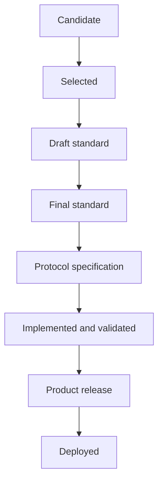

**Question this answers:** what is the difference between a candidate, a selected algorithm, a draft, a final standard, an RFC, a validated module, and something running in my estate? **Background:** [Standardisation](/learn/standardisation/).

Each stage below is real progress, and each is routinely mistaken for the next. Knowing the stage tells you how much a claim is worth and what to ask next.

## The stages

| Stage | What it means | Example (status checked 20 November 2026) |
| --- | --- | --- |
| **Candidate** | Submitted to a public evaluation process and analysed in rounds | NIST's additional digital signature schemes; NIST IR 8610 (14 May 2026) reports on the second round |
| **Selected** | Chosen for standardisation at the end of evaluation; not yet specified as a standard | HQC, selected in NIST IR 8545 (March 2025) as an alternative to ML-KEM |
| **Draft standard** | Published text open for public comment; can change | NIST SP 800-230 initial public draft (13 April 2026) |
| **Final standard** | Approved specification of the algorithm | FIPS 203, 204, and 205 (13 August 2024) |
| **Protocol specification** | Defines how a protocol or format uses the algorithm | RFC 10024 hybrid TLS key agreement (August 2026); RFC 9881 ML-DSA in X.509 certificates (October 2025) |
| **Implemented and validated** | Code exists in libraries or hardware; where required, a module is validated under FIPS 140-3 | NIST IR 8547 (§3) says NIST is revising CMVP processes to accelerate validation of post-quantum modules |
| **Product release** | A supplier ships a version with the capability | Supplier release notes and version numbers |
| **Deployed** | Enabled, negotiated, and evidenced on your systems | Your own change records |

## Things that are easy to confuse

- **Selected is not standardised.** NIST IR 8547 (§2.1.2) says a FIPS for HQC is under development; until it is published, HQC is not an approved scheme.
- **Draft is not final.** NIST drafts close their comment periods and are then revised; SP 800-230's comment period closed on 12 June 2026, but it remains a draft.
- **Not every RFC is a standard.** RFC 10024 is on the IETF Standards Track; RFC 9954 on hybrid key-exchange design (July 2026) is Informational. An Internet-Draft is neither.
- **An algorithm in a library is not a feature in a product.** The product must expose it, and you must enable it.
- **A validated module is not a validated product.** Validation applies to the module tested, in the configuration tested.

## How to use this

When a supplier, colleague, or article says something "supports" or "is compliant with" post-quantum cryptography, place the claim on the table above. Then ask for the evidence for the next stage along. [Reading "quantum-safe" claims](/learn/explainers/quantum-safe-claims/) turns this into a set of questions, and [Work with suppliers](/programme/suppliers/) shows how to record the answers.

## Sources

- NIST, Post-Quantum Cryptography publications list, accessed 20 November 2026. [NIST publications list](https://csrc.nist.gov/Projects/Post-Quantum-Cryptography/publications)
- NIST, Status Report on the Fourth Round of the NIST Post-Quantum Cryptography Standardization Process, NIST IR 8545, March 2025. [NIST IR 8545](https://csrc.nist.gov/pubs/ir/8545/final)
- NIST, Additional SLH-DSA Parameter Sets for Limited Signature Use Cases, SP 800-230 (initial public draft), 13 April 2026. [SP 800-230 draft](https://csrc.nist.gov/pubs/sp/800/230/ipd)
- NIST, Module-Lattice-Based Key-Encapsulation Mechanism Standard, FIPS 203, 13 August 2024. [FIPS 203](https://csrc.nist.gov/pubs/fips/203/final)
- NIST, Transition to Post-Quantum Cryptography Standards, NIST IR 8547, October 2026 (§2.1.2, §3). [NIST IR 8547](https://doi.org/10.6028/NIST.IR.8547)
- NIST, Security Requirements for Cryptographic Modules, FIPS 140-3, 22 March 2019. [FIPS 140-3](https://csrc.nist.gov/pubs/fips/140-3/final)
- IETF, Post-Quantum Traditional (PQ/T) Hybrid Key Agreement Mechanisms for TLS 1.3, RFC 10024, August 2026. [RFC 10024](https://www.rfc-editor.org/rfc/rfc10024)
- IETF, Hybrid Key Exchange in TLS 1.3, RFC 9954, July 2026. [RFC 9954](https://www.rfc-editor.org/rfc/rfc9954)
- IETF, Internet X.509 Public Key Infrastructure — Algorithm Identifiers for the Module-Lattice-Based Digital Signature Algorithm (ML-DSA), RFC 9881, October 2025. [RFC 9881](https://www.rfc-editor.org/rfc/rfc9881)

## Related pages

- [Standardisation](/learn/standardisation/)
- [Post-quantum cryptography standards](/standards/post-quantum/)
- [Work with suppliers](/programme/suppliers/)
