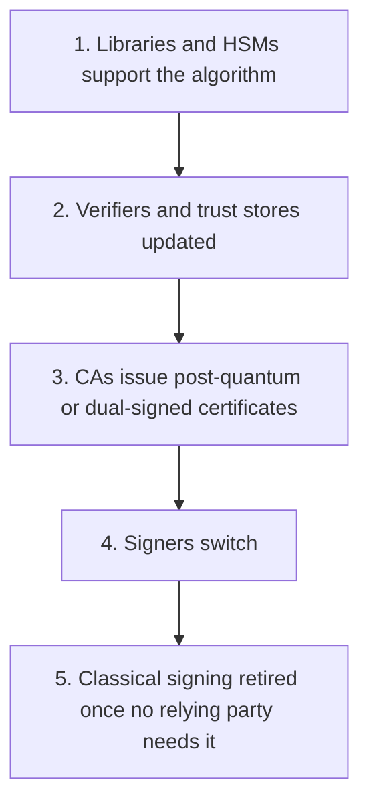

**Question this answers:** why can a team switch its TLS key exchange in one release, but not its signatures? **Background:** [Signatures, certificates, and trust](/learn/signatures-and-trust/).

Key establishment usually involves two parties negotiating at the start of a connection; if both support a new algorithm, they use it. A signature is created once and checked by everyone who later relies on it — sometimes for years, sometimes by devices the signer has never seen. Changing the algorithm is only useful once those verifiers can check it, and harmful if it breaks the ones that cannot.

## Who has to move

Take one signed artefact — a firmware image, a server certificate, or a signed document — and list everyone who touches its signature.

| Party | What they hold or run | What has to change |
| --- | --- | --- |
| Root and intermediate certification authorities | Signing keys, certificate profiles, revocation services | New post-quantum keys, possibly new roots; signing certificates and revocation data with the new algorithm |
| Hardware security modules at the CA or publisher | Private keys and signing operations | Firmware or hardware that supports the algorithm |
| Signers (servers, build pipelines, people) | Private keys and certificates | New key pairs and certificates; pipeline and tooling changes |
| Trust stores (operating systems, browsers, devices) | Trust anchors | New anchors distributed and trusted |
| Verifiers (libraries, browsers, boot code, document readers) | Verification code | Support for the new algorithm and, if used, dual-signature formats |
| Relying parties (users, services, auditors) | Policies on what to accept | Updated acceptance rules |

[NIST IR 8547](https://doi.org/10.6028/NIST.IR.8547) (October 2026, §2.2.4) says PKI components must be updated to issue certificates and sign revocation information with post-quantum algorithms, and that backward compatibility and interoperability during the transition are crucial. Section 3.1.2 adds that supporting quantum-resistant authentication requires upgrades to both the system performing and the system accepting it, plus supporting infrastructure, and may require new hardware tokens.

## The usual order

Verifiers generally have to move *before* signers switch, or signatures will be rejected. That makes the slowest verifier — often an embedded device or an unmanaged client — the pace-setter. During the transition, NIST IR 8547 (§3.2) expects PKIs using quantum-vulnerable algorithms to operate alongside those using quantum-resistant ones; dual signatures are one way to serve both, at the cost of complexity.

## Why urgency comes from time, not data

Recorded signatures do not leak secrets later, so there is no harvest-now, decrypt-later pressure. NIST IR 8547 (§3) still calls the signature transition urgent because it lasts longer, is more complex, and involves more parties. Section 3.1.2 adds a sharper edge: authentication systems can keep using quantum-vulnerable algorithms until a capable quantum computer is available, at which point they would need to transition *immediately*. An organisation that has not prepared its verifiers cannot do that.

## Worked example

The fictional manufacturer in [Protect this first](/resources/protect-this-first/) is developing a product sensor whose firmware verifier holds its trust anchor in write-protected boot ROM. To use a post-quantum signature for that firmware, it would need a signing key in hardware that supports the algorithm, a build pipeline that produces the new signature, and — critically — a verifier in the boot ROM that accepts it. Because the verifier cannot change after the sensor ships, every other party's readiness is irrelevant if the ROM decision is wrong; the product security lead therefore has to settle the signature and trust-root option before production design freeze, and records it under [Firmware and secure boot](/technology-options/firmware-secure-boot/).

## What to take away

- Count verifiers, not just signers; the slowest verifier sets the pace.
- Infrastructure (HSMs, CAs, trust stores) usually has to move before applications.
- Plan signature migrations as multi-party programmes with an agreed order and rollback.

## Sources

- NIST, Transition to Post-Quantum Cryptography Standards, NIST IR 8547, October 2026 (§2.2.4, §3, §3.1.2, §3.2). [NIST IR 8547](https://doi.org/10.6028/NIST.IR.8547)

## Related pages

- [Signatures, certificates, and trust](/learn/signatures-and-trust/)
- [PKI and certificates](/technology-options/pki/)
- [Hash-based signatures](/learn/explainers/hash-based-signatures/)
