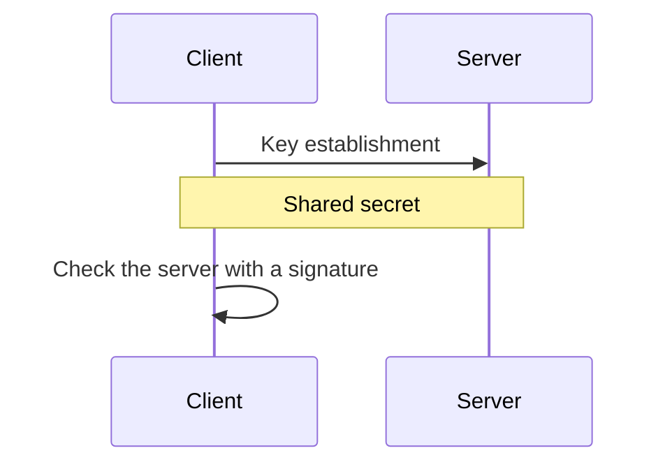

Where is the shared secret established in a TLS connection, and how is that different from checking who the server is?

[In real systems](/learn/in-real-systems/) places key establishment in TLS sessions. The shared secret and the check of who the server is are separate jobs.

The figure shows one connection. Key establishment produces the shared secret, and checking the server is a separate signature check.

Across all three deployment patterns, server authentication remains a separate signature check:

| Exchange | What establishes the shared secret | What still authenticates the server |
| --- | --- | --- |
| Classical | Today's public-key key establishment | A separate signature check |
| Hybrid | A classical key establishment and a post-quantum key establishment used together | A separate signature check |
| Post-quantum-only | Post-quantum key establishment alone | A separate signature check |

[NIST IR 8547](https://doi.org/10.6028/NIST.IR.8547) (October 2026) treats hybrid constructions as a temporary hedge during transition. Similarly, the [UK NCSC timelines](https://www.ncsc.gov.uk/guidance/pqc-migration-timelines) (published and reviewed 20 March 2025) note that popular browsers already agree post-quantum keys using a hybrid of classical key exchange and ML-KEM, while an exact industry-wide profile was still being finalised at publication.

The same split holds for a classical exchange, a hybrid exchange, and a post-quantum-only exchange.

That is the same distinction as [In real systems](/learn/in-real-systems/). From here, read [Learn the basics](/learn/).

## Sources

- NIST IR 8547, Transition to Post-Quantum Cryptography Standards, October 2026. [NIST IR 8547](https://doi.org/10.6028/NIST.IR.8547)
- UK NCSC, Post-quantum cryptography migration timelines, published and reviewed 20 March 2025. [UK NCSC timelines](https://www.ncsc.gov.uk/guidance/pqc-migration-timelines)
