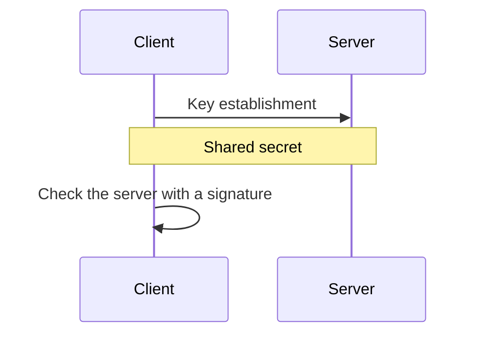

Where is the shared secret established in a TLS connection, and how is that different from checking who the server is?

You have read [In real systems](/learn/in-real-systems/). The further distinction is where the shared secret is established, and how that differs from checking who the server is.

The figure shows one connection. Key establishment produces the shared secret. Checking the server is a separate signature check.

**Handbook explanation:**

| Exchange | What establishes the shared secret | What still authenticates the server |
| --- | --- | --- |
| Classical | Today's public-key key establishment | A separate signature check |
| Hybrid | A classical key establishment and a post-quantum key establishment used together | A separate signature check |
| Post-quantum-only | Post-quantum key establishment alone | A separate signature check |

**Authority recommendation:** [NIST IR 8547](https://doi.org/10.6028/NIST.IR.8547), October 2026, treats a hybrid construction as a temporary hedge.

**Authority recommendation:** The [UK NCSC timelines](https://www.ncsc.gov.uk/guidance/pqc-migration-timelines), modified 3 August 2026, note that popular browsers can agree a post-quantum key using a hybrid of traditional key exchange and ML-KEM, and that an exact industry-wide mechanism was not yet standardised at publication, so further updates can be expected.

Key establishment produces the shared secret. Checking the server is a separate signature check. That split holds for a classical exchange, a hybrid exchange, and a post-quantum-only exchange.

This distinction continues from [In real systems](/learn/in-real-systems/).

Next: [Learn the basics](/learn/).

## Sources

- NIST IR 8547, Transition to Post-Quantum Cryptography Standards, October 2026. [NIST IR 8547](https://doi.org/10.6028/NIST.IR.8547)
- UK NCSC, Post-quantum cryptography migration timelines, modified 3 August 2026. [UK NCSC timelines](https://www.ncsc.gov.uk/guidance/pqc-migration-timelines)
