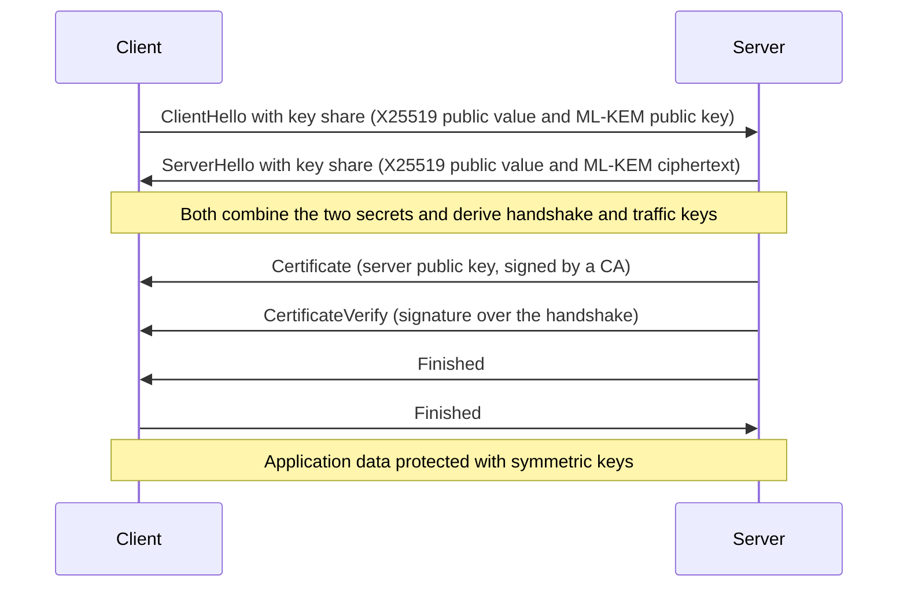

**Question this answers:** when someone says "our TLS supports post-quantum cryptography", what has actually changed? **Background:** [What a KEM is](/learn/explainers/kem/), [Signatures, certificates, and trust](/learn/signatures-and-trust/).

TLS combines several cryptographic jobs in one connection. The TLS 1.3 specification, [RFC 9846](https://www.rfc-editor.org/rfc/rfc9846) (July 2026, which obsoletes RFC 8446 of August 2018), separates them in its protocol overview: **key exchange** establishes shared keying material, and **authentication** authenticates the server (and optionally the client) and confirms the handshake. Symmetric encryption then protects the application data. Post-quantum migration reaches these jobs at different times.

## The handshake, step by step

| Step | Job | What post-quantum migration changes |
| --- | --- | --- |
| Key shares in ClientHello and ServerHello | Key exchange | A hybrid group such as X25519MLKEM768 replaces a classical group. The client sends an ML-KEM public key; the server replies with a ciphertext. |
| Certificate and CertificateVerify | Server authentication | A post-quantum signature algorithm and certificate chain would be needed. RFC 9846 describes CertificateVerify as a signature over the entire handshake using the private key matching the certificate. |
| Record protection | Traffic encryption | Nothing; symmetric algorithms continue. |

## Where key exchange stands

[RFC 10024](https://www.rfc-editor.org/rfc/rfc10024) (August 2026, Proposed Standard) defines three hybrid key-agreement groups for TLS 1.3: X25519MLKEM768, SecP256r1MLKEM768, and SecP384r1MLKEM1024. A separate specification for ML-KEM on its own (draft-ietf-tls-mlkem) is in the RFC Editor queue.

The UK NCSC's [TLS guidance](https://www.ncsc.gov.uk/guidance/using-tls-to-protect-data) (15 October 2026) recommends a hybrid profile using X25519MLKEM768 or SecP256r1MLKEM768, recommends hybrid schemes as an interim measure when migrating, and considers pure ML-KEM acceptable for TLS. [NIST IR 8547](https://doi.org/10.6028/NIST.IR.8547) (October 2026, §4.2) calls TLS an early priority because it is a primary target for harvest-now, decrypt-later collection, describes TLS 1.3 as a practical near-term path to quantum-resistant key establishment including hybrid mechanisms, and says the next revision of NIST SP 800-52 will reflect this.

Because the key-share format is negotiated, clients and servers can offer both classical and hybrid groups; a connection uses whichever both sides support. That is coexistence, not a hybrid in itself — see [Hybrid cryptography](/learn/hybrid/).

## Where authentication stands

The NCSC guidance states that, at present, the IETF has standardised post-quantum algorithms only for key exchange in TLS, that work is ongoing to standardise post-quantum authentication in TLS and the wider Web PKI, and that until then organisations should continue using ECDSA and RSA. Certificates are a many-party system — CAs, browsers, trust stores, servers — so this layer moves more slowly, as [Why signatures affect more than the signer](/learn/explainers/signature-dependencies/) explains.

## Reading a claim about TLS

"TLS supports PQC" usually means post-quantum or hybrid **key exchange** is available. Before recording it, establish:

- Which TLS version, and which named group is actually negotiated with your clients?
- Is it enabled by default, or does it need configuration?
- Is it on every hop — load balancer, CDN, internal service — or only the edge?
- What signature algorithm does the server certificate use, and when will that change?

## Sources

- IETF, The Transport Layer Security (TLS) Protocol Version 1.3, RFC 9846, July 2026 (obsoletes RFC 8446). [RFC 9846](https://www.rfc-editor.org/rfc/rfc9846)
- IETF, Post-Quantum Traditional (PQ/T) Hybrid Key Agreement Mechanisms for TLS 1.3, RFC 10024, August 2026. [RFC 10024](https://www.rfc-editor.org/rfc/rfc10024)
- IETF Datatracker, ML-KEM Post-Quantum Key Agreement for TLS 1.3, draft-ietf-tls-mlkem-11. [Datatracker](https://datatracker.ietf.org/doc/draft-ietf-tls-mlkem/)
- NIST, Transition to Post-Quantum Cryptography Standards, NIST IR 8547, October 2026 (§3.1.3, §4.2). [NIST IR 8547](https://doi.org/10.6028/NIST.IR.8547)
- UK National Cyber Security Centre, Using Transport Layer Security to protect data, 15 October 2026. [NCSC TLS guidance](https://www.ncsc.gov.uk/guidance/using-tls-to-protect-data)

## Related pages

- [In real systems](/learn/in-real-systems/)
- [Forward secrecy and recorded traffic](/learn/explainers/forward-secrecy/)
- [NIST SP 800-52](/standards/modules-protocols-certificates/sp-800-52/)
- [RFC 10024](/standards/modules-protocols-certificates/rfc-10024/)
