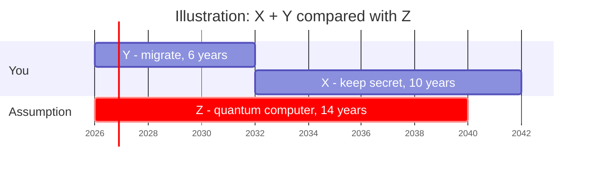

**Question this answers:** if no one knows when a quantum computer will arrive, how do you decide when to start? **Background:** [The quantum threat](/learn/quantum-threat/), [Timelines](/learn/timelines/).

## The inequality

The reasoning most authorities use is named after the researcher Michele Mosca. [NIST IR 8547](https://doi.org/10.6028/NIST.IR.8547) (October 2026, §3) summarises it with three quantities:

- **X** — how many years the data must stay secure (its confidentiality period);
- **Y** — how many years it will take to complete the transition;
- **Z** — how many years until a cryptanalytically relevant quantum computer exists.

If **X + Y** is greater than **Z**, some data will still need protecting after a quantum computer can read it. Organisations need to start before X + Y exceeds Z. [The PQC Migration Handbook](https://english.aivd.nl/site/binaries/site-content/collections/documents/2024/12/3/the-pqc-migration-handbook/The+PQC+Migration+Handbook+.pdf) (AIVD, CWI, and TNO, December 2024) adds that the closer X + Y is to Z, the more urgent the migration. The inequality shows when your own exposure begins. It does not replace published dates that govern you, which can fall earlier; [Timelines](/learn/timelines/) explains how to tell which apply.

In this illustration, X + Y is 16 years and Z is 14, so the last data protected by classical key establishment would be exposed for its final two years. The sooner migration finishes (a smaller Y), the smaller that gap.

## Choosing the numbers

**X is yours to determine.** It comes from the data, not the technology: legal retention periods, contract terms, the life of a design or a medical record, or how long a negotiating position stays sensitive. The EU NIS Cooperation Group [roadmap](https://digital-strategy.ec.europa.eu/en/library/coordinated-implementation-roadmap-transition-post-quantum-cryptography) (version 1.1, 11 June 2025) treats a confidentiality use case as high-risk if a compromise after ten years or more would still cause significant damage, and recommends that such data be protected against quantum attack by the end of 2030.

**Y is usually longer than expected.** NIST IR 8547 (§1) observes that moving from algorithm standardisation to full integration has historically taken 10 to 20 years; the EU roadmap estimates 5 to 10 years to migrate all relevant systems. Your Y depends on supplier release dates, hardware refresh cycles, and change windows — the subject of [Set dates and milestones](/plan/programme/dates/).

**Z is not knowable, so use a range.** The EU roadmap reports a BSI-commissioned study judging a capable machine likely within at most 16 years of 2024 (by 2040 or earlier), and possibly within 10. The Dutch handbook reports expert-survey estimates, with a conservative reading of 2040. These are inputs from named studies, not handbook predictions. A sensible approach is to test whether your conclusion changes across a plausible range of Z rather than pick a single year. Give the earlier end of that range real weight: published resource estimates have fallen since the BSI update. Google and Cloudflare have both set 2029 to finish migrating their own services, a target for their migration rather than an estimate of Z; [The quantum threat](/learn/quantum-threat/#what-remains-uncertain) explains why.

## A worked example

The fictional manufacturer in [Protect this first](/templates/examples/protect-this-first/) holds product designs in a supplier-hosted archive that its retention policy says must stay confidential for 15 years (X = 15). Suppose, as an illustration, that it had assumed migration would take four years (Y = 4). Then X + Y = 19 years — beyond even the later estimates for Z reported above, so the archive's key establishment heads the key-establishment order on the [register](/templates/records/register/), whatever the national completion date for the organisation as a whole. In the worked example the supplier's planned release with hybrid X25519MLKEM768 shortens Y considerably for the archive's connections, though not yet for its stored files, whose protection the supplier has not described. Shortening Y is exactly the lever the inequality points to: X is fixed by policy, Z is outside anyone's control, and Y is the only term the organisation can reduce.

## Limits of the model

- It covers **confidentiality** — the key-establishment clock. Signatures do not accumulate harvest-now exposure; their timing is driven by coordination and device lifetimes (see [Why signatures affect more than the signer](/learn/explainers/signature-dependencies/)).
- It is a **prioritisation aid**, not a risk assessment. It does not weigh the value of the data or the capability of particular attackers.
- Published **authority dates still apply** where they govern you, even if your own X + Y suggests you could go later.

## Sources

- NIST, Transition to Post-Quantum Cryptography Standards, NIST IR 8547, October 2026 (§1, §3). [NIST IR 8547](https://doi.org/10.6028/NIST.IR.8547)
- EU NIS Cooperation Group PQC work stream, A Coordinated Implementation Roadmap for the Transition to Post-Quantum Cryptography, version 1.1, 11 June 2025 (§4, §5). [EU roadmap](https://digital-strategy.ec.europa.eu/en/library/coordinated-implementation-roadmap-transition-post-quantum-cryptography)
- AIVD, CWI, and TNO, The PQC Migration Handbook, second edition, December 2024 (migration planning, estimating Z). [Handbook](https://english.aivd.nl/site/binaries/site-content/collections/documents/2024/12/3/the-pqc-migration-handbook/The+PQC+Migration+Handbook+.pdf)

## Related pages

- [The quantum threat](/learn/quantum-threat/)
- [Decide what to migrate first](/plan/programme/priority/)
- [Technology options](/technology-options/)
