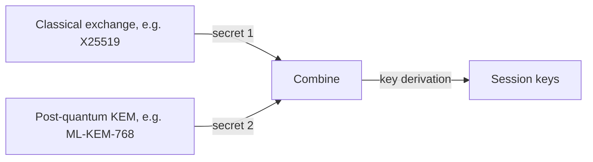

"Hybrid" is one of the most used and least defined words in post-quantum guidance. It describes a specific construction — combining a traditional and a post-quantum algorithm in a single operation — and authorities take different positions on when to use it. This lesson defines the term, separates its key-establishment and signature forms, and shows why you should record whose advice you are following.

## The definition

The IETF's [RFC 9794](https://www.rfc-editor.org/rfc/rfc9794) (June 2025) defines a post-quantum/traditional (PQ/T) hybrid scheme as a multi-algorithm scheme in which at least one component is post-quantum and at least one is traditional. [NIST IR 8547](https://doi.org/10.6028/NIST.IR.8547) (October 2026, §3.2) uses the term the same way, and adds that hybrids can also combine two post-quantum algorithms that rely on different mathematical assumptions.

The aim, in NIST's words, is a construction designed to remain secure if at least one of its components is secure. It is a hedge: if a flaw is found in the new algorithm or its implementation, the traditional component still protects against classical attackers; if a quantum computer arrives, the post-quantum component still holds.

## Hybrid key establishment

In a hybrid key exchange, both algorithms run and their outputs are combined into one secret. NIST IR 8547 (§3.2.1) describes the generic approach NIST allows: concatenate the two shared secrets and feed the result into an approved key-derivation function. TLS 1.3 now has standardised hybrids: [RFC 10024](https://www.rfc-editor.org/rfc/rfc10024) (August 2026) defines X25519MLKEM768, SecP256r1MLKEM768, and SecP384r1MLKEM1024, each pairing an elliptic-curve exchange with ML-KEM.

## Hybrid signatures

For signatures, the usual technique is a **dual signature**: two or more signatures over the same data, all of which must verify (NIST IR 8547 §3.2.2). These can be packaged as a single *composite* signature. Dual signatures can sign documents or certificates. They are harder to deploy than hybrid key exchange, because every verifier has to understand the combined format, and NIST notes that their security properties are complex and need careful analysis.

## Coexistence is not hybrid

During the transition, most systems will support old and new algorithms at the same time and negotiate one per session. NIST IR 8547 (§3.2) is explicit that this is **not** a hybrid solution if each session uses only a single algorithm for key establishment or signatures. A server that accepts either classical or post-quantum key exchange is offering *choice*; a server that runs both in the same handshake is running a *hybrid*. The distinction matters when you record what a product actually does.

## Authorities disagree

| Authority | Position |
| --- | --- |
| NIST (US), IR 8547, October 2026 | Hybrids add complexity, cost, and potential risk; when used they are typically temporary, leading to a second transition to post-quantum-only. NIST leaves the decision to each application and accommodates hybrid key establishment and dual signatures in FIPS 140 validation. |
| UK NCSC, [Next steps](https://www.ncsc.gov.uk/whitepaper/next-steps-preparing-for-post-quantum-cryptography), August 2024; [TLS guidance](https://www.ncsc.gov.uk/guidance/using-tls-to-protect-data), 15 October 2026 | Hybrid may sometimes be needed (for interoperability, implementation security, or protocol constraints) and, if chosen, should be an interim measure. For TLS 1.3 it recommends hybrid profiles as an interim measure and considers pure ML-KEM acceptable. |
| EU NIS Cooperation Group, [roadmap](https://digital-strategy.ec.europa.eu/en/library/coordinated-implementation-roadmap-transition-post-quantum-cryptography) v1.1, 11 June 2025 | Recommends standardised and tested hybrid solutions whenever feasible and suitable. |
| AIVD, CWI, and TNO, [PQC Migration Handbook](https://english.aivd.nl/site/binaries/site-content/collections/documents/2024/12/3/the-pqc-migration-handbook/The+PQC+Migration+Handbook+.pdf), December 2024 | Reports that Germany, France, and the Netherlands advocate hybrid deployment, while the UK recommends it only when necessary. |

None of these positions is universal. Record which one applies to the system and why; [Choosing an option](/technology-options/choosing/) shows how.

## Check your understanding

- What makes a scheme hybrid, as opposed to merely supporting two algorithms?
- Why is a hybrid signature harder to deploy than a hybrid key exchange?
- If a supplier says "we use hybrid", what two follow-up questions would you ask?

Continue with [Standardisation](/learn/standardisation/).

## Sources

- IETF, Terminology for Post-Quantum Traditional Hybrid Schemes, RFC 9794, June 2025. [RFC 9794](https://www.rfc-editor.org/rfc/rfc9794)
- IETF, Post-Quantum Traditional (PQ/T) Hybrid Key Agreement Mechanisms for TLS 1.3, RFC 10024, August 2026. [RFC 10024](https://www.rfc-editor.org/rfc/rfc10024)
- NIST, Transition to Post-Quantum Cryptography Standards, NIST IR 8547, October 2026 (§3.2). [NIST IR 8547](https://doi.org/10.6028/NIST.IR.8547)
- EU NIS Cooperation Group PQC work stream, A Coordinated Implementation Roadmap for the Transition to Post-Quantum Cryptography, version 1.1, 11 June 2025. [EU roadmap](https://digital-strategy.ec.europa.eu/en/library/coordinated-implementation-roadmap-transition-post-quantum-cryptography)
- UK National Cyber Security Centre, Next steps in preparing for post-quantum cryptography, version 2.0, August 2024. [NCSC whitepaper](https://www.ncsc.gov.uk/whitepaper/next-steps-preparing-for-post-quantum-cryptography)
- UK National Cyber Security Centre, Using Transport Layer Security to protect data, 15 October 2026. [NCSC TLS guidance](https://www.ncsc.gov.uk/guidance/using-tls-to-protect-data)
- AIVD, CWI, and TNO, The PQC Migration Handbook, second edition, December 2024. [Handbook](https://english.aivd.nl/site/binaries/site-content/collections/documents/2024/12/3/the-pqc-migration-handbook/The+PQC+Migration+Handbook+.pdf)

## Related pages

- [Learn the basics](/learn/)
- [Choosing an option](/technology-options/choosing/)
- [What a KEM is](/learn/explainers/kem/)
