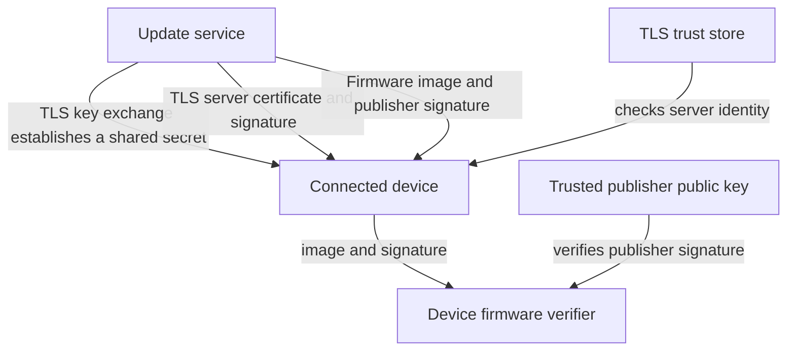

Post-quantum migration does not happen to "the cryptography" as a single switch. It happens to protocols, libraries, hardware, certificates, and update chains — each owned by someone, each changed on its own schedule. This lesson maps the common places public-key cryptography lives to the jobs it does there, then follows one device through two separate changes.

## A map of common systems

[NIST IR 8547](https://doi.org/10.6028/NIST.IR.8547) (October 2026, §2.2 and §3.1) lists the components and use cases that must change. The table arranges them by job.

| System | Key establishment (confidentiality, harvest-now exposure) | Signatures (authentication, coordination) | What typically has to change |
| --- | --- | --- | --- |
| TLS (web, APIs, many internal services) | Yes — handshake key exchange | Yes — server, sometimes client, certificates | Library and server or client release; certificates later |
| VPNs and IPsec | Yes — Internet Key Exchange (IKE) | Yes — peer authentication | Gateway and client releases |
| SSH | Yes | Yes — host and user keys | Client, server, and key management |
| Email (S/MIME, OpenPGP) | Yes — message keys are encrypted to the recipient | Yes — sender signatures | Clients, key directories, certificates |
| Code and firmware signing | No | Yes | Signing pipeline, keys, and every verifier, including boot code |
| PKI and certification authorities | No | Yes — they sign certificates and revocation data | CA software, HSMs, certificate profiles, relying-party software |
| Smart cards, identity credentials, tokens | Sometimes | Yes | Cards and readers on multi-year replacement cycles |
| HSMs, TPMs, secure elements | Hosts both | Hosts both | Firmware or hardware upgrade; long design lead times |
| Software cryptographic libraries | Provide both | Provide both | Library upgrade before any application can migrate |

Three patterns follow from the table:

- **Dependencies run downwards.** Applications cannot use an algorithm their library or HSM lacks, and NIST IR 8547 (§2.2) notes that infrastructure such as PKI may need to change before applications can.
- **Key establishment is moving first.** NIST IR 8547 (§4.2) expects application guidance to prioritise quantum-resistant key establishment in interactive protocols such as TLS and IKE, because of harvest-now, decrypt-later.
- **Identity and hardware move slowest.** NIST IR 8547 (§4.2) points to personal identity credentials, whose cards, readers, middleware, and PKI all need updating on multi-year cycles.

## One device, two changes

A connected device that downloads a firmware update shows why the jobs need separate records.

The device checks the server during the TLS connection, then separately checks the publisher's signature on the firmware image.

- Moving the **download connection** to hybrid or post-quantum key exchange protects the image in transit against harvest-now, decrypt-later. The UK NCSC's [TLS guidance](https://www.ncsc.gov.uk/guidance/using-tls-to-protect-data) (15 October 2026) recommends post-quantum key-exchange profiles for TLS 1.3 while noting that post-quantum authentication in TLS is still being standardised, so the server certificate may stay classical for now.
- Moving the **firmware signature** requires a post-quantum signing key at the publisher *and* a verifier on the device that understands it. If that verifier lives in immutable boot code, no TLS change can help; that is the [long-lived verifier](/learn/signatures-and-trust/) case.

Updating TLS does not update the firmware verifier, and updating the signing pipeline does not protect the download. Record them as two changes with two owners.

## Supplier release versus your configuration

For most organisations, the work is not writing cryptography but getting it from suppliers and turning it on. The [Standardisation](/learn/standardisation/) layers apply here: configuration can enable support a product already ships; it cannot add support that is absent from the build. The UK NCSC's [migration timelines](https://www.ncsc.gov.uk/guidance/pqc-migration-timelines) (20 March 2025) expect that, for smaller organisations using commodity IT, migration will largely arrive as services are updated by their vendors — while bespoke software follows the same timetable as for larger organisations.

## Check your understanding

- Which rows in the table carry harvest-now, decrypt-later exposure?
- Why might a TLS migration be complete while a device's firmware signature migration has not started?
- What is the difference between a product *supporting* ML-KEM and your system *using* it?

Continue with [Timelines](/learn/timelines/). For the handshake in more detail, read [What changes in a TLS connection](/learn/explainers/tls/).

## Sources

- NIST, Transition to Post-Quantum Cryptography Standards, NIST IR 8547, October 2026 (§2.2, §3.1, §4.2). [NIST IR 8547](https://doi.org/10.6028/NIST.IR.8547)
- UK National Cyber Security Centre, Using Transport Layer Security to protect data, 15 October 2026. [NCSC TLS guidance](https://www.ncsc.gov.uk/guidance/using-tls-to-protect-data)
- UK National Cyber Security Centre, Timelines for migration to post-quantum cryptography, published 20 March 2025. [UK NCSC timelines](https://www.ncsc.gov.uk/guidance/pqc-migration-timelines)

## Related pages

- [Learn the basics](/learn/)
- [Inventory the cryptography](/plan/programme/inventory/)
- [Core actions](/plan/core-actions/)
