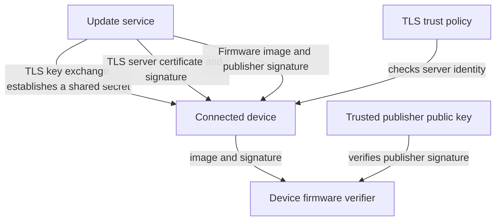

Post-quantum mechanisms appear in products, protocols, and trust systems—not as a single switch. A connected device receiving a software update shows why the cryptographic jobs need to be considered separately.

The diagram shows a simplified update. The download connection and the signature on the firmware image use separate cryptographic checks.

The device checks the server during the TLS connection, then separately checks the publisher's signature on the firmware. A post-quantum or hybrid key-exchange profile can protect the connection while the server authentication remains classical. Updating TLS does not update the device's firmware verifier or its trusted publisher key.

The same product may therefore need distinct changes for data in transit and for signed updates. A hybrid key-exchange profile combines a classical and a post-quantum mechanism during transition; it does not automatically replace the signature algorithms or certificates used to authenticate the server. NIST IR 8547 (October 2026) describes hybrid constructions as a transition measure.

This example also connects the standards lesson to product reality: a FIPS standard specifies an algorithm, a protocol profile specifies how it is used, and a supplier release makes that support available in a product. Configuration can enable support the product already ships; it cannot add support that is absent from the build. For TLS, [the NCSC's updated guidance](https://www.ncsc.gov.uk/guidance/using-tls-to-protect-data) now covers post-quantum profiles, while authentication and the wider public-key infrastructure have a separate transition path.

The FIPS standard does not set the date by which an organisation must update the connection or the device. That date comes from migration guidance or a directive for the organisation's audience, and key-establishment and signature milestones may differ. [Timelines](/learn/timelines/) explains the distinction, with examples in [Why migration timelines differ](/learn/explainers/timelines/).

Continue with [Standardisation](/learn/standardisation/).

For how key exchange and server authentication remain separate in a TLS connection, read [What changes in a TLS connection](/learn/explainers/tls/).

## Sources

- NIST IR 8547, Transition to Post-Quantum Cryptography Standards, October 2026. [NIST IR 8547](https://doi.org/10.6028/NIST.IR.8547)
- UK National Cyber Security Centre, Using Transport Layer Security to protect data, updated 15 October 2026. [NCSC TLS guidance](https://www.ncsc.gov.uk/guidance/using-tls-to-protect-data)

## Related pages

- [Learn the basics](/learn/)
- [Algorithms](/learn/algorithms/)
