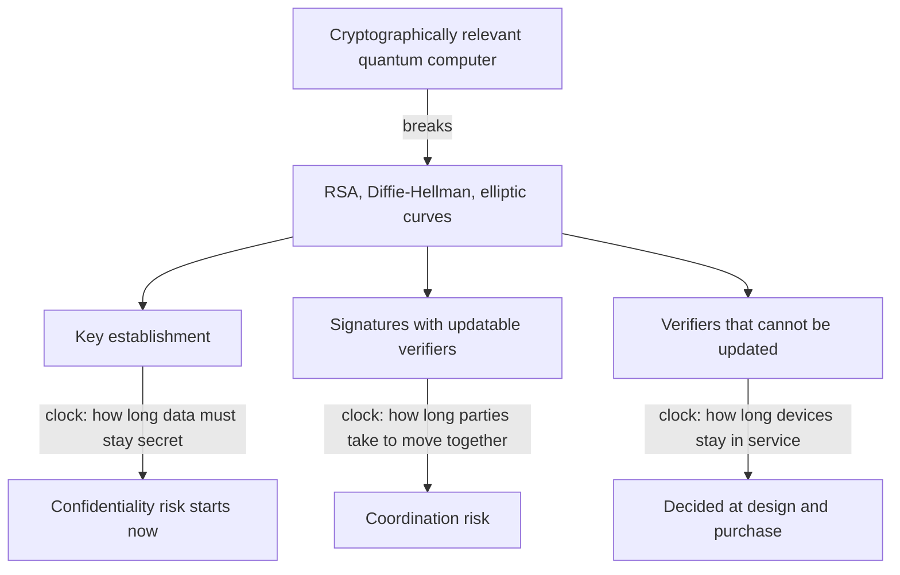

This section gives security, engineering, product, procurement, and risk professionals a shared, accurate model of the cryptography affected by a post-quantum migration. It assumes you understand systems, suppliers, certificates, and change control. It does not assume any mathematics. It is conceptual grounding, not a migration procedure; when you are ready to plan, go to [Plan your migration](/plan/). The worked examples, [Protect this first](/templates/examples/protect-this-first/) and [Stay on supplier updates](/templates/examples/stay-on-supplier-updates/), show a plan applied, and the glossary defines terms.

## The model in one picture

Public-key cryptography does three kinds of work that a quantum computer would affect, and each runs on its own clock.

## What you will be able to explain

After the core lessons you should be able to:

- separate key establishment from signatures, and say which one harvest-now, decrypt-later threatens;
- explain why symmetric cryptography such as AES is not being replaced;
- name ML-KEM, ML-DSA, SLH-DSA, and the stateful hash-based schemes, and say what each is for;
- say what "hybrid" means and why authorities disagree about it;
- tell an algorithm standard apart from a protocol specification, a validated module, a product release, and a deployment;
- read any migration date by asking who set it, for whom, for which job, and for which milestone.

## Core lessons

Read these in order. Each takes about five minutes and ends with a short self-check.

1. [Public-key cryptography](/learn/public-key-cryptography/) — the jobs public-key cryptography does, and how it differs from symmetric cryptography.
2. [Signatures, certificates, and trust](/learn/signatures-and-trust/) — certificates, chains, trust anchors, and verifiers that cannot be updated.
3. [The quantum threat](/learn/quantum-threat/) — what a quantum computer breaks, what it does not, harvest-now, decrypt-later, and what decides when to act.
4. [What post-quantum means](/learn/what-post-quantum-means/) — post-quantum versus quantum cryptography, and what "quantum-resistant" promises.
5. [Post-quantum algorithms](/learn/algorithms/) — ML-KEM, ML-DSA, SLH-DSA, LMS and XMSS, and what is coming next.
6. [Hybrid cryptography](/learn/hybrid/) — hybrid key exchange, dual signatures, and differing authority positions.
7. [Standardization](/learn/standardization/) — the five layers between a standard and a protected system, with current status.
8. [In real systems](/learn/in-real-systems/) — where each job sits in TLS, VPNs, email, code signing, PKI, and hardware.
9. [Timelines](/learn/timelines/) — five questions for any date, the three clocks, and dates that bind someone else.
10. [Crypto-agility](/learn/crypto-agility/) — why this is not the last transition, and how to move into planning.

## Reading by role

All ten lessons are short; if you only have time for some, these are the most useful starting points.

| Role | Start with | Then |
| --- | --- | --- |
| Security or risk lead | 3, 9 | [When to start](/learn/explainers/when-to-start/) |
| Engineering or product | 1, 5, 8 | [What changes in a TLS connection](/learn/explainers/tls/) |
| Procurement or supplier management | 7, 2 | [Reading "quantum-safe" claims](/learn/explainers/quantum-safe-claims/) |
| Executive sponsor | 3, 9, 10 | [Why migration timelines differ](/learn/explainers/why-timelines-differ/) |

## Explainers

Optional explainers expand one distinction each. Read them when a lesson leaves you wanting the mechanism or the evidence.

- [What the keys actually do](/learn/explainers/keys/) — which key does which job in each scheme.
- [Why signatures affect more than the signer](/learn/explainers/signature-dependencies/) — everyone who must move together when a signature algorithm changes.
- [What a quantum computer changes](/learn/explainers/quantum-computers/) — Shor and Grover side by side, and when harm can occur.
- [When to start: Mosca's inequality](/learn/explainers/when-to-start/) — data lifetime plus migration time against the arrival of a quantum computer.
- [Forward secrecy and recorded traffic](/learn/explainers/forward-secrecy/) — why ephemeral keys do not stop harvest-now, decrypt-later.
- [What a KEM is](/learn/explainers/kem/) — encapsulation, decapsulation, and how KEMs differ from Diffie–Hellman.
- [Hash-based signatures](/learn/explainers/hash-based-signatures/) — stateless and stateful designs, and why state matters for firmware signing.
- [What changes in a TLS connection](/learn/explainers/tls/) — the handshake step by step, and why authentication lags key exchange.
- [From research to deployment](/learn/explainers/research-to-deployment/) — the path from candidate algorithm to something running in your estate.
- [Reading "quantum-safe" claims](/learn/explainers/quantum-safe-claims/) — turning a supplier statement into checkable facts.
- [Choosing a post-quantum library](/learn/explainers/choosing-a-library/) — what to check about a library's testing, validation, maintenance, license, and support, whether open-source or commercial.
- [Why migration timelines differ](/learn/explainers/why-timelines-differ/) — NIST, US federal, UK, EU, and Australian dates compared.

Use the [glossary](/learn/glossary/) for definitions while reading.

## Sources

- NIST, Transition to Post-Quantum Cryptography Standards, NIST IR 8547, October 2026. [NIST IR 8547](https://doi.org/10.6028/NIST.IR.8547)

## Related pages

- [Homepage](/)
- [Which plan you need](/plan/)
- [Standards](/standards/)
