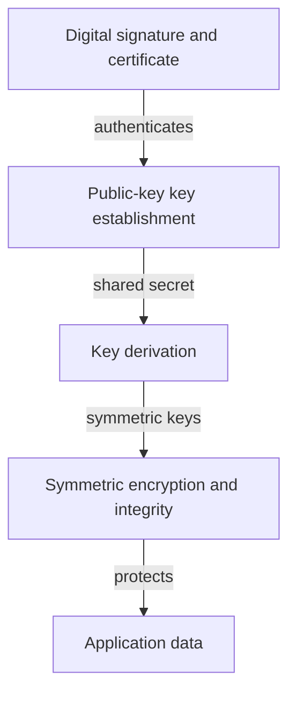

A post-quantum migration replaces public-key cryptography, not all cryptography. Before planning one, it helps to be precise about what public-key cryptography does in a system and which of those jobs a quantum computer would affect. This lesson separates the jobs; later lessons attach a different migration driver to each.

## Two families of cryptography

**Symmetric cryptography** uses one shared secret key. The same key encrypts and decrypts, or creates and checks a message authentication code. AES and the SHA-2 and SHA-3 hash functions belong to this family. Symmetric algorithms are fast and protect almost all the bulk data that moves through a network or sits in storage. [NIST IR 8547](https://doi.org/10.6028/NIST.IR.8547) (October 2026) lists encryption, data authentication, key derivation, key wrapping, and random bit generation as their uses.

Symmetric cryptography has one hard problem: both parties need the same secret before they start. Two systems that have never met cannot simply send a key across an open network.

**Public-key cryptography** (also called asymmetric cryptography) uses a key pair. The public key can be published; the private key stays with its owner. RSA, Diffie–Hellman, and elliptic-curve cryptography (ECC) are the families in use today. Public-key operations are slower and produce larger values than symmetric ones, so systems use them sparingly — usually at the start of a connection or once per document — to solve the problems symmetric cryptography cannot solve alone.

## The jobs public-key cryptography does

| Job | Question it answers | What it produces | Examples |
| --- | --- | --- | --- |
| **Key establishment** | How do two parties get a shared secret over an open channel? | A shared secret from which symmetric keys are derived | Diffie–Hellman in a TLS handshake; a key-encapsulation mechanism (KEM) |
| **Digital signature** | Did the holder of this private key approve exactly this data? | A signature that anyone with the public key can check | Certificates, software updates, signed documents |
| **Public-key encryption** (narrower, older use) | Can I encrypt something that only the private-key holder can read? | A ciphertext | RSA key transport, some email encryption |

NIST describes the first two as separate parts of the transition in [NIST IR 8547](https://doi.org/10.6028/NIST.IR.8547) §2.1, and the rest of this handbook keeps them separate: key establishment protects **confidentiality**; signatures protect **authenticity and integrity**.

Key establishment is not the same as encrypting the data. The public-key step agrees a secret; symmetric algorithms derived from that secret then protect the traffic or file. The diagram shows that division of labour in a typical secure connection.

A digital signature works the other way round from encryption. The private key creates the signature; the public key checks it. A valid check shows that the data has not changed and that it was signed with the private key matching that public key. It does not, on its own, tell you *who* holds that key. That link comes from certificates and trust decisions, covered in the next lesson.

## Where these jobs appear

Most systems use more than one job at once:

- **A TLS or VPN connection** uses key establishment to agree session keys and a signature (via a certificate) to authenticate the server.
- **A software or firmware update** uses a signature so the device can check the publisher; the download channel may separately use TLS.
- **Encrypted email** (S/MIME or OpenPGP) uses public-key cryptography to protect the message key and signatures to authenticate the sender, as NIST IR 8547 §3.1.4 notes.
- **Smart cards, hardware security modules (HSMs), and Trusted Platform Modules (TPMs)** store private keys and perform signature or key-establishment operations inside protected hardware.

Because the jobs differ, a single system can need two migrations on two timetables: one for the key establishment that protects its data in transit, another for the signatures that authenticate it.

## Check your understanding

- Which family protects the bulk of the data in a connection, and which sets it up?
- Why does "the connection uses RSA" not tell you which job RSA is doing?
- What does a valid signature prove on its own, and what does it not prove?

Continue with [Signatures, certificates, and trust](/learn/signatures-and-trust/). For the role of each key in each scheme, read [What the keys actually do](/learn/explainers/keys/).

## Sources

- NIST, Transition to Post-Quantum Cryptography Standards, NIST IR 8547, October 2026 (§2.1, §3.1.4). [NIST IR 8547](https://doi.org/10.6028/NIST.IR.8547)
- NIST, Digital Signature Standard, FIPS 186-5, February 2023. [FIPS 186-5](https://csrc.nist.gov/pubs/fips/186-5/final)
- NIST, Recommendation for Pair-Wise Key-Establishment Schemes Using Discrete Logarithm Cryptography, SP 800-56A Rev. 3, April 2018. [SP 800-56A Rev. 3](https://csrc.nist.gov/pubs/sp/800/56/a/r3/final)
- NIST, Module-Lattice-Based Key-Encapsulation Mechanism Standard, FIPS 203, 13 August 2024. [FIPS 203](https://csrc.nist.gov/pubs/fips/203/final)
- IETF, PKCS #1: RSA Cryptography Specifications Version 2.2, RFC 8017, November 2016. [RFC 8017](https://www.rfc-editor.org/rfc/rfc8017)

## Related pages

- [Learn the basics](/learn/)
- [What the keys actually do](/learn/explainers/keys/)
- [Glossary](/resources/reference/glossary/)
