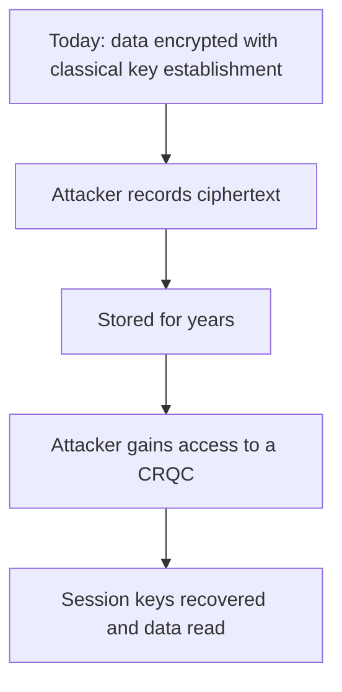

Quantum computers are not faster versions of today's computers. For most tasks they offer no advantage. For a few specific mathematical problems, though, known quantum algorithms are dramatically better than any known classical method, and two of those problems happen to underpin today's public-key cryptography. This lesson explains what is threatened, what is not, and why the risk to some data starts before such a machine exists.

## What would be broken

The threat comes from a machine large and reliable enough to run these attacks at useful scale. The UK NCSC's [Next steps in preparing for post-quantum cryptography](https://www.ncsc.gov.uk/paper/next-steps-in-preparing-for-post-quantum-cryptography) (August 2024) calls this a cryptographically relevant quantum computer (CRQC); NIST uses the term *cryptanalytically* relevant. No such machine exists today: [NIST IR 8547](https://doi.org/10.6028/NIST.IR.8547) (October 2026, §3) says there are no existing cryptanalytically relevant quantum computers that currently threaten security levels.

**Shor's algorithm** solves integer factorisation and discrete logarithms efficiently. Those problems are the basis of RSA, Diffie–Hellman, and elliptic-curve cryptography. NIST IR 8547 §2.1 lists the signature algorithms in FIPS 186 (ECDSA, EdDSA, RSA) and the key-establishment schemes in SP 800-56A and SP 800-56B (finite-field and elliptic-curve Diffie–Hellman and MQV, and RSA) as vulnerable to Shor's algorithm on such a machine. Increasing key sizes does not fix this; the algorithms have to be replaced.

**Grover's algorithm** speeds up brute-force search, which in principle helps an attacker guess a symmetric key or find a hash preimage. The speed-up is far smaller and much harder to exploit in practice. NIST IR 8547 §4.1.3 states that NIST's symmetric standards are significantly less vulnerable to known quantum attacks, and that approved symmetric primitives giving at least 128 bits of classical security are believed to meet the lowest post-quantum security category. The NCSC whitepaper likewise says that existing symmetric algorithms with at least 128-bit keys, such as AES, can continue to be used.

| Cryptography | Quantum algorithm | Effect | What the transition does |
| --- | --- | --- | --- |
| RSA, Diffie–Hellman, ECC (public-key) | Shor | Broken outright by a CRQC | Replace with post-quantum algorithms |
| AES and other symmetric ciphers with keys of at least 128 bits | Grover | Reduced margin; not broken | No replacement needed under NIST and NCSC guidance |
| SHA-2 and SHA-3 hash functions | Generic quantum search | Significantly less vulnerable than public-key schemes | No replacement needed for approved variants, although NIST will disallow its few 112-bit-strength symmetric options in 2030 |

This is why the handbook does not cover a symmetric migration programme: NIST says it does not expect to need to move away from its symmetric standards as part of the post-quantum migration (IR 8547 §2.1.3).

## Harvest-now, decrypt-later

An attacker who records encrypted traffic or copies encrypted files today can store them and wait. If the public-key key establishment that protected those sessions is later broken, the attacker can recover the session keys and read the data. NIST IR 8547 §1 describes this as one of the main reasons the transition is urgent, because sensitive data often keeps its value for many years.

The risk applies to **confidentiality**, through key establishment and public-key encryption. It does not apply to signatures in the same way: a recorded signature does not reveal a secret later. Forging signatures becomes possible only once a CRQC exists, which is why signature urgency depends on coordination time and device lifetimes rather than on data already collected. The [previous lesson](/learn/signatures-and-trust/) covers that clock.

## What remains uncertain

Nobody can say when a CRQC will exist. The NCSC whitepaper says it is hard to predict because many engineering and physical challenges remain. The EU NIS Cooperation Group [roadmap](https://digital-strategy.ec.europa.eu/en/library/coordinated-implementation-roadmap-transition-post-quantum-cryptography) (version 1.1, 11 June 2025) reports that a 2024 update of a study for Germany's BSI judged such a machine likely to be feasible by 2040 or earlier, and possibly within ten years of that update if current error-correction heuristics are fully verified. Treat such estimates as planning inputs from named studies, not forecasts the handbook endorses. They describe when a machine may become feasible, not when you would learn that one exists.

Some of the largest operators have moved faster than the authority schedules. On 25 March 2026 Google ([Quantum frontiers may be closer than they appear](https://blog.google/innovation-and-ai/technology/safety-security/cryptography-migration-timeline/)) set 2029 as its post-quantum migration target, citing progress in quantum hardware, error correction, and estimates of the resources needed to factor RSA keys, and said it now prioritises authentication services. On 31 March Google Research [reported](https://research.google/blog/safeguarding-cryptocurrency-by-disclosing-quantum-vulnerabilities-responsibly/) that a superconducting CRQC with fewer than 500,000 physical qubits could solve the 256-bit elliptic-curve discrete-logarithm problem in minutes, publishing a zero-knowledge proof of the result instead of the attack circuits. Cloudflare ([Cloudflare targets 2029 for full post-quantum security](https://blog.cloudflare.com/post-quantum-roadmap/), 7 April 2026) then set 2029 for its own services, citing that result among other new estimates, and made post-quantum authentication its top priority. These are targets the companies set for their own services, not dates that bind anyone else. They show that published resource estimates have fallen, and that the products and services you depend on will change on their suppliers' schedule, not yours.

So the arrival date is not the whole decision. Three things decide when you act:

- **Your exposure.** How long your data must stay confidential, how long the migration will take, and how long your devices will be in service. [When to start](/learn/explainers/when-to-start/) shows how those numbers combine.
- **The dates that apply to you.** Some authorities set dates without waiting for a CRQC. NIST will deprecate quantum-vulnerable public-key algorithms under its standards after 2030 and disallow them after 2035 (IR 8547 §4). The UK NCSC's [timelines for migration](https://www.ncsc.gov.uk/guidance/pqc-migration-timelines) set milestones in 2028, 2031, and 2035 for large organisations, critical national infrastructure, and organisations with bespoke IT. The NCSC bases its 2035 target on how long it expects standards, products, and uptake to take, and warns that organisations which do not migrate in time will end up running significant legacy estates. [Timelines](/learn/timelines/) explains how to tell which dates govern you.
- **Your threat level.** The NCSC whitepaper says harvest-now, decrypt-later is only likely to be worthwhile for very high-value information. [The PQC Migration Handbook](https://english.aivd.nl/documents/2024/12/3/the-pqc-migration-handbook) (AIVD, CWI, and TNO, December 2024) asks how realistic it is that an attacker with a quantum computer would choose to target your organisation. Cloudflare's roadmap expects progress towards a CRQC to leave the public eye; if it does, the first capable machine may not be announced. Data that would interest a well-resourced adversary argues for planning against the earlier estimates and moving it early in the order set in [Decide what to migrate first](/migration-practices/priority/). Keeping lower-value data later in that order is a decision for legal or risk to accept, recorded with its reasons.

## Check your understanding

- Why does doubling an RSA key size not solve the quantum threat, when larger symmetric keys are not even necessary?
- Which job is exposed to harvest-now, decrypt-later, and which is not?
- Apart from when a CRQC might exist, what three things decide when you should act?

Continue with [What post-quantum means](/learn/what-post-quantum-means/). For the timing of harm to encrypted data and signatures, read [What a quantum computer changes](/learn/explainers/quantum-computers/).

## Sources

- NIST, Transition to Post-Quantum Cryptography Standards, NIST IR 8547, October 2026 (§1, §2.1, §3, §4.1.3). [NIST IR 8547](https://doi.org/10.6028/NIST.IR.8547)
- UK National Cyber Security Centre, Next steps in preparing for post-quantum cryptography, version 2.0, August 2024. [NCSC whitepaper](https://www.ncsc.gov.uk/paper/next-steps-in-preparing-for-post-quantum-cryptography)
- UK National Cyber Security Centre, Timelines for migration to post-quantum cryptography, published 20 March 2025. [UK NCSC timelines](https://www.ncsc.gov.uk/guidance/pqc-migration-timelines)
- EU NIS Cooperation Group PQC work stream, A Coordinated Implementation Roadmap for the Transition to Post-Quantum Cryptography, version 1.1, 11 June 2025 (§5). [EU roadmap](https://digital-strategy.ec.europa.eu/en/library/coordinated-implementation-roadmap-transition-post-quantum-cryptography)
- AIVD, CWI, and TNO, The PQC Migration Handbook, second edition, December 2024 (PQC personas, threat level). [Handbook](https://english.aivd.nl/documents/2024/12/3/the-pqc-migration-handbook)
- Google, Quantum frontiers may be closer than they appear, 25 March 2026. [Google blog](https://blog.google/innovation-and-ai/technology/safety-security/cryptography-migration-timeline/)
- Google Research, Safeguarding cryptocurrency by disclosing quantum vulnerabilities responsibly, 31 March 2026. [Google Research blog](https://research.google/blog/safeguarding-cryptocurrency-by-disclosing-quantum-vulnerabilities-responsibly/)
- Cloudflare, Cloudflare targets 2029 for full post-quantum security, 7 April 2026. [Cloudflare blog](https://blog.cloudflare.com/post-quantum-roadmap/)

## Related pages

- [Learn the basics](/learn/)
- [What a quantum computer changes](/learn/explainers/quantum-computers/)
- [When to start: Mosca's inequality](/learn/explainers/when-to-start/)
