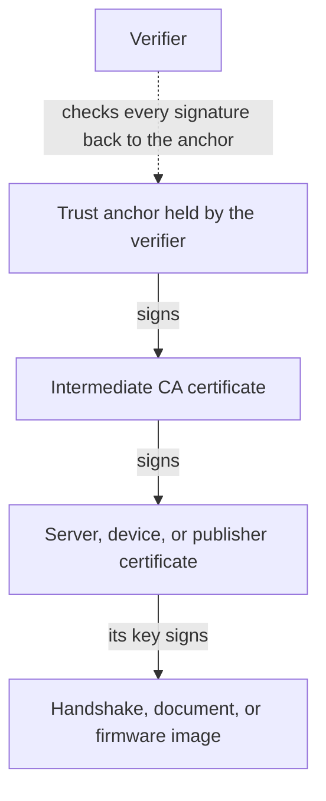

A signature check proves that data matches a public key. Systems need more than that: they need to know whose key it is and whether to accept it. That is the job of certificates, trust anchors, and the software that checks them. This lesson explains the parts, because a post-quantum signature migration has to change all of them, and because some of them cannot be changed once a product ships.

## From a signature to a trust decision

- A **certificate** binds a name (a website, a device, a software publisher) to a public key. A certification authority (CA) signs that binding.
- A **certificate chain** links the certificate you are checking, through one or more intermediate CA certificates, to a certificate the checking system already trusts.
- A **trust anchor** (often a root certificate or a built-in public key) is the starting point the system trusts without further proof. Browsers and operating systems ship trust stores full of them; a device may hold a single publisher key in its boot code.
- A **verifier** is the code that performs the checks: the browser's certificate validation, a server checking client certificates, or the boot ROM that checks firmware before it runs.
- A **relying party** is whoever acts on the result — the user, the service, or the device.

Every link in that chain carries a signature. Replacing the signature algorithm therefore means new keys and certificates at the CA, new signing in the publisher's pipeline, and verifiers everywhere that understand the new algorithm. [NIST IR 8547](https://doi.org/10.6028/NIST.IR.8547) (October 2026, §2.2.4) notes that public-key infrastructure (PKI) components must be updated to issue certificates and sign revocation information with post-quantum algorithms, and that infrastructure may need to change *before* the applications that depend on it can migrate.

## Why signatures run on a different clock

Signatures are not exposed to harvest-now, decrypt-later: a recorded signature does not leak any secret later. [NIST IR 8547](https://doi.org/10.6028/NIST.IR.8547) §3.1.2 states that an authentication system stays secure as long as its algorithms are secure *at the time the check is performed*. The same report (§3) still calls the signature transition urgent, because it takes longer, is more complex, and needs more parties to coordinate. A CA cannot switch until relying parties can check its new signatures; relying parties gain nothing until CAs and signers issue them.

## Verifiers that cannot be updated

The hardest case is a verifier fixed in hardware or immutable boot code. If a device checks its firmware against a classical public key burned in at manufacture, no software update can teach it a new algorithm. NIST IR 8547 §3.1.1 advises that, where verification code cannot be updated after manufacture and the device may still be in use once a cryptanalytically relevant quantum computer exists, the device should be designed to require quantum-resistant signatures on its code from the start.

National guidance reflects this. The UK NCSC's [migration timelines](https://www.ncsc.gov.uk/guidance/pqc-migration-timelines) (20 March 2025) ask organisations to identify any requirement to migrate long-lived hardware roots of trust in their initial plan by 2028. The EU NIS Cooperation Group [roadmap](https://digital-strategy.ec.europa.eu/en/library/coordinated-implementation-roadmap-transition-post-quantum-cryptography) (version 1.1, 11 June 2025) highly recommends that products with an expected lifetime beyond 2030 be upgradable to post-quantum cryptography, with update mechanisms that use post-quantum signatures.

This is why the handbook treats three jobs, not two:

| Job | What drives urgency | Typical coordination |
| --- | --- | --- |
| Key establishment | How long the protected data must stay confidential | Usually the two ends of a connection |
| Signatures (updatable verifiers) | Time needed to move signers, CAs, and relying parties together | Many parties, often across organisations |
| Long-lived or non-updatable verifiers | Whether the device will outlive the classical algorithm it trusts | Decided at design and procurement, not later |

## Check your understanding

- Which parts of a certificate chain must change when the signature algorithm changes?
- Why is a signature not at risk from recorded traffic, yet still urgent to migrate?
- What decision has to be made before a device ships if its verifier cannot be updated?

Continue with [The quantum threat](/learn/quantum-threat/). For a worked list of everyone who must move together, read [Why signatures affect more than the signer](/learn/explainers/signature-dependencies/).

## Sources

- NIST, Transition to Post-Quantum Cryptography Standards, NIST IR 8547, October 2026 (§2.2.4, §3, §3.1.1, §3.1.2). [NIST IR 8547](https://doi.org/10.6028/NIST.IR.8547)
- UK National Cyber Security Centre, Timelines for migration to post-quantum cryptography, published 20 March 2025. [UK NCSC timelines](https://www.ncsc.gov.uk/guidance/pqc-migration-timelines)
- EU NIS Cooperation Group PQC work stream, A Coordinated Implementation Roadmap for the Transition to Post-Quantum Cryptography, version 1.1, 11 June 2025 (published by the European Commission on 23 June 2025). [EU roadmap](https://digital-strategy.ec.europa.eu/en/library/coordinated-implementation-roadmap-transition-post-quantum-cryptography)

## Related pages

- [Learn the basics](/learn/)
- [PKI and certificates](/technology-options/pki/)
- [Firmware and secure boot](/technology-options/firmware-secure-boot/)
