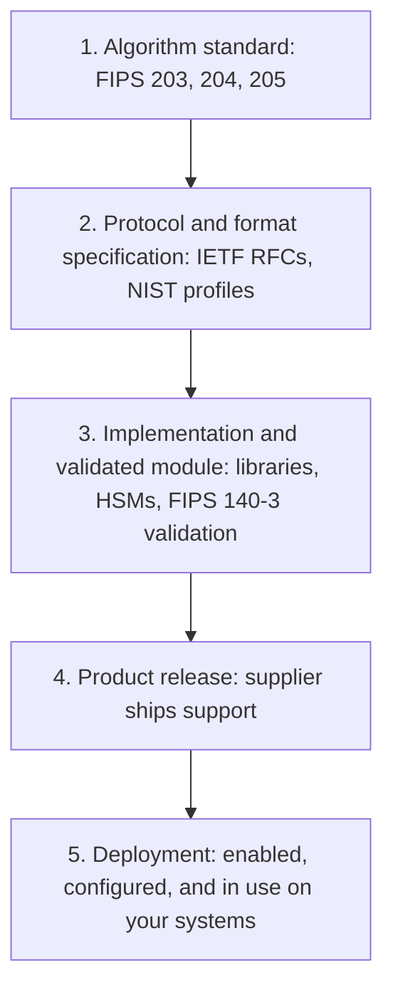

"NIST has standardized post-quantum cryptography" is true, and it is often read as "products now support it". The two statements are several layers apart. Each layer is produced by a different body, on a different schedule, and a system is protected only when every layer it depends on is in place. This lesson names the layers and shows where each stands.

## Five layers

1. **Algorithm standard.** A Federal Information Processing Standard (FIPS) defines the algorithm exactly — key generation, operations, parameter sets. It says nothing about how TLS, certificates, or a firmware format should carry it.
2. **Protocol and format specification.** Bodies such as the Internet Engineering Task Force (IETF) define how an algorithm is identified and used in a protocol or data format: which TLS key-exchange groups exist, how an ML-DSA key appears in an X.509 certificate. NIST also publishes usage profiles, such as SP 800-52 for TLS.
3. **Implementation and validation.** Cryptographic libraries and hardware modules implement the algorithms. Where an organization needs validated cryptography, the module is tested under [FIPS 140-3](https://csrc.nist.gov/pubs/fips/140-3/final) (March 22, 2019), which sets security requirements for the design, implementation, and operation of cryptographic modules. NIST IR 8547 (§3) notes that NIST is revising Cryptographic Module Validation Program (CMVP) processes to speed up validation of modules implementing post-quantum algorithms.
4. **Product release.** A supplier ships a version that includes the implementation and exposes it. Configuration can only enable what the build already contains.
5. **Deployment.** The capability is turned on, negotiated in practice, and evidenced on your own systems.

A draft at any layer is not final, and a final standard at one layer does not imply anything about the next.

## Current status

| Item | Layer | Status | Source |
| --- | --- | --- | --- |
| FIPS 203 (ML-KEM), FIPS 204 (ML-DSA), FIPS 205 (SLH-DSA) | Algorithm | Final, August 13, 2024 | NIST CSRC |
| SP 800-208 (LMS, XMSS) | Algorithm | Final, October 2020 | NIST CSRC |
| SP 800-227, Recommendations for KEMs | Algorithm usage | Final, September 2025 | NIST CSRC |
| HQC key establishment | Algorithm | Selected (IR 8545, March 2025); FIPS under development | NIST IR 8545, IR 8547 |
| FALCON-derived signature | Algorithm | FIPS under development | NIST IR 8547 |
| SP 800-230, additional SLH-DSA parameter sets | Algorithm | Initial public draft, April 13, 2026 | NIST CSRC |
| Hybrid ML-KEM key agreement for TLS 1.3 | Protocol | RFC 10024, Proposed Standard, August 2026 | IETF |
| ML-KEM-only key agreement for TLS 1.3 | Protocol | Internet-Draft in the RFC Editor queue (draft-ietf-tls-mlkem-11, September 16, 2026) | IETF Datatracker |
| ML-DSA in X.509 certificates | Format | RFC 9881, Proposed Standard, October 2025 | IETF |
| Post-quantum authentication in TLS and the Web PKI | Protocol | Still being standardized, according to the UK NCSC (October 15, 2026) | NCSC TLS guidance |
| ML-DSA authentication in TLS 1.3 | Protocol | Internet-Draft in the RFC Editor queue (draft-ietf-tls-mldsa-06, September 11, 2026) | IETF Datatracker |
| Post-quantum cryptography in TLS 1.2 | Protocol | Will not be specified: TLS 1.2 is in feature freeze (RFC 9851, Proposed Standard, July 2026) | IETF |
| NIST TLS guidance (SP 800-52) | Profile | Next revision to cover quantum-resistant and hybrid key exchange (IR 8547 §4.2) | NIST IR 8547 |

Statuses change independently. Check NIST's [post-quantum publications list](https://csrc.nist.gov/Projects/Post-Quantum-Cryptography/publications), the IETF Datatracker, and your supplier's release notes before relying on any row. For a second view of layer 2, the Post-Quantum Cryptography Coalition, a non-governmental community, publishes a [State of the Migration](https://pqcc.org/learn-more/state-of-the-migration/) heatmap scoring each protocol separately for post-quantum confidentiality and authentication; its latest is for June 2026. [Technology options](/technology-options/) gives the same split for each technology. [From research to deployment](/learn/explainers/research-to-deployment/) explains each stage in more detail.

## What this means in practice

- When a supplier says they support a standard, ask which layer they mean: an algorithm in a library, a protocol profile, a validated module, or a feature switched on by default.
- Key establishment for TLS has reached layer 2; signatures in TLS and the public Web PKI have not, according to the NCSC. That gap is why so many products protect connections with post-quantum key exchange while still authenticating with classical certificates.
- Algorithm standards do not set your migration date. That comes from the authority that governs you, covered in [Timelines](/learn/timelines/).

## Check your understanding

- A product data sheet says "FIPS 203 compliant". Which layers does that statement leave unanswered?
- Why can TLS key exchange move ahead of TLS authentication?
- Which layer can configuration change, and which can it not?

Continue with [In real systems](/learn/in-real-systems/).

## Sources

- NIST, Module-Lattice-Based Key-Encapsulation Mechanism Standard, FIPS 203, August 13, 2024. [FIPS 203](https://csrc.nist.gov/pubs/fips/203/final)
- NIST, Module-Lattice-Based Digital Signature Standard, FIPS 204, August 13, 2024. [FIPS 204](https://csrc.nist.gov/pubs/fips/204/final)
- NIST, Stateless Hash-Based Digital Signature Standard, FIPS 205, August 13, 2024. [FIPS 205](https://csrc.nist.gov/pubs/fips/205/final)
- NIST, Recommendation for Stateful Hash-Based Signature Schemes, SP 800-208, October 2020. [SP 800-208](https://csrc.nist.gov/pubs/sp/800/208/final)
- NIST, Recommendations for Key-Encapsulation Mechanisms, SP 800-227, September 2025. [SP 800-227](https://csrc.nist.gov/pubs/sp/800/227/final)
- NIST, Additional SLH-DSA Parameter Sets for Limited Signature Use Cases, SP 800-230 (initial public draft), April 13, 2026. [SP 800-230 draft](https://csrc.nist.gov/pubs/sp/800/230/ipd)
- NIST, Status Report on the Fourth Round of the NIST Post-Quantum Cryptography Standardization Process, NIST IR 8545, March 2025. [NIST IR 8545](https://csrc.nist.gov/pubs/ir/8545/final)
- NIST, Transition to Post-Quantum Cryptography Standards, NIST IR 8547, October 2026 (§2.1, §3, §4.2). [NIST IR 8547](https://doi.org/10.6028/NIST.IR.8547)
- NIST, Security Requirements for Cryptographic Modules, FIPS 140-3, March 22, 2019. [FIPS 140-3](https://csrc.nist.gov/pubs/fips/140-3/final)
- NIST, Post-Quantum Cryptography publications list. [NIST publications list](https://csrc.nist.gov/Projects/Post-Quantum-Cryptography/publications)
- IETF, Post-Quantum Traditional (PQ/T) Hybrid Key Agreement Mechanisms for TLS 1.3, RFC 10024, August 2026. [RFC 10024](https://www.rfc-editor.org/rfc/rfc10024)
- IETF, Internet X.509 Public Key Infrastructure — Algorithm Identifiers for the Module-Lattice-Based Digital Signature Algorithm (ML-DSA), RFC 9881, October 2025. [RFC 9881](https://www.rfc-editor.org/rfc/rfc9881)
- IETF Datatracker, ML-KEM Post-Quantum Key Agreement for TLS 1.3, draft-ietf-tls-mlkem-11. [Datatracker](https://datatracker.ietf.org/doc/draft-ietf-tls-mlkem/)
- UK National Cyber Security Centre, Using Transport Layer Security to protect data, October 15, 2026. [NCSC TLS guidance](https://www.ncsc.gov.uk/guidance/using-tls-to-protect-data)
- IETF, TLS 1.2 is in Feature Freeze, RFC 9851, July 2026. [RFC 9851](https://www.rfc-editor.org/info/rfc9851)
- IETF Datatracker, Use of ML-DSA in TLS 1.3, draft-ietf-tls-mldsa-06. [Datatracker](https://datatracker.ietf.org/doc/draft-ietf-tls-mldsa/)
- Post-Quantum Cryptography Coalition, State of the Migration, June 2026 heatmap. [PQCC heatmap](https://pqcc.org/learn-more/state-of-the-migration/)

## Related pages

- [Learn the basics](/learn/)
- [Post-quantum cryptography standards](/standards/post-quantum/)
- [FIPS 140-3](/standards/modules-protocols-certificates/fips-140-3/)
- [Modules, protocols, and certificates](/standards/modules-protocols-certificates/)
