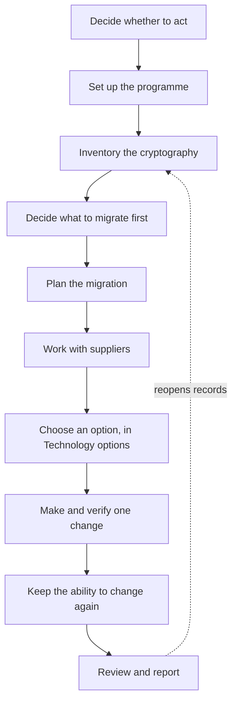

Start with [Decide whether to act](/migration-practices/diagnose/). Four questions place you on one of two paths:

- **The short path.** If every asset answers no to all four questions and meets the five conditions on Decide whether to act, you mostly need to [keep commodity software updated](/migration-practices/commodity-software/), write post-quantum requirements into purchases and renewals ([Work with suppliers](/migration-practices/suppliers/), step 5), and [review](/migration-practices/subsequent-review/) regularly.
- **The full path.** If any asset's path is full under the table on Decide whether to act, because it answers yes to one of the questions, you need a programme. Follow the practices in this order:

The order is a dependency order, not a strict sequence: supplier work usually runs alongside planning, and review reopens earlier records whenever something changes. Choosing an option sits in [Technology options](/technology-options/choosing/) because it is a technical decision about mechanisms rather than an operating practice.

Each practice says when it applies, who does what, the steps, the evidence to keep, and what an insufficient record looks like next to a decision-ready one. The [situation routes](/routes/) set out the two paths and the tracks an asset can follow; each one points into these practices, which hold the full method.

The practices are written for organisations without specialist cryptography staff. They do not replace a formal risk assessment or specialist advice on large bespoke estates, critical national infrastructure, or regulated systems; where a practice reaches that boundary, it says so and routes the decision to the risk owner, sector authority, or specialist.

## The practices

| Practice | Who leads | Record it produces |
| --- | --- | --- |
| [Decide whether to act](/migration-practices/diagnose/) | Executive sponsor with the migration lead | [Decision note](/resources/records/decision-note/) and first [inventory](/resources/records/inventory/) rows |
| [Keep commodity software updated](/migration-practices/commodity-software/) | Operations | Checked versions in the [inventory record](/resources/records/inventory/) |
| [Set up the programme](/migration-practices/programme/) | Executive sponsor | [Programme charter](/resources/records/programme-charter/) |
| [Inventory the cryptography](/migration-practices/inventory/) | Migration lead with asset owners | [Inventory record](/resources/records/inventory/) |
| [Decide what to migrate first](/migration-practices/priority/) | Migration lead with legal or risk | Order and reason on the [migration plan](/resources/records/migration-plan/) |
| [Plan the migration](/migration-practices/plan/) | Migration lead | Timeline, milestone, and four dates on the [migration plan](/resources/records/migration-plan/) |
| [Work with suppliers](/migration-practices/suppliers/) | Procurement with asset owners | [Vendor response log](/resources/records/vendor-response-log/) and [purchase requirements](/resources/records/purchase-requirements/) |
| [Choose an option](/technology-options/choosing/), in Technology options | Asset owner, with specialist advice where needed | Option and authority on the [change record](/resources/records/change-record/) |
| [Make and verify one change](/migration-practices/implementation/) | Asset owner with operations | [Change record](/resources/records/change-record/), including its evidence |
| [Keep the ability to change again](/migration-practices/changing-algorithms-again/) | Asset owner | Agility evidence in existing records |
| [Review and report](/migration-practices/subsequent-review/) | Migration lead, reporting to the sponsor | [Review log](/resources/records/review-log/) and [progress report](/resources/records/progress-report/) |

## Where to start by role

- **Anyone unsure whether this applies.** [Decide whether to act](/migration-practices/diagnose/), which also says what to do when you cannot yet answer or choose.
- **IT or operations, on the short path.** [Keep commodity software updated](/migration-practices/commodity-software/).
- **Procurement or supplier management.** [Work with suppliers](/migration-practices/suppliers/), which covers existing suppliers, purchases, renewals, and customers who ask you.
- **Owners of systems that must change.** [Inventory the cryptography](/migration-practices/inventory/) and [Make and verify one change](/migration-practices/implementation/).
- **Accountable for the programme.** [Set up the programme](/migration-practices/programme/) and [Review and report](/migration-practices/subsequent-review/).

Each practice keeps key establishment, digital signatures, and verifiers that cannot be updated as separate lines, because their urgency and coordination differ. The [Protect this first](/resources/examples/protect-this-first/) worked example follows one fictional manufacturer through every record.

## Sources

- AIVD, CWI, and TNO, The PQC Migration Handbook, second edition, December 2024. [The PQC Migration Handbook (PDF)](https://english.aivd.nl/site/binaries/site-content/collections/documents/2024/12/3/the-pqc-migration-handbook/The+PQC+Migration+Handbook+.pdf)

## Related pages

- [Situation routes](/routes/)
- [Migration records](/resources/records/)
- [Technology options](/technology-options/)
- [Migration guides](/standards/migration-guides/)
