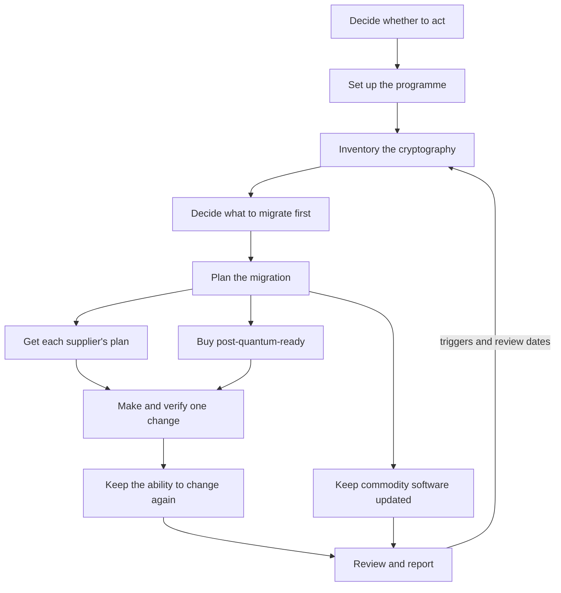

These practices are the operating steps of a post-quantum migration: deciding whether and how urgently to act, setting up the programme, finding and prioritising the cryptography, planning dates, working with suppliers, making each change safely, and keeping the records current. Each practice says when it applies, who does what, the steps, the evidence to keep, and what an insufficient record looks like next to a decision-ready one.

The practices are written for organisations without specialist cryptography staff. They do not replace a formal risk assessment or specialist advice on large bespoke estates, critical national infrastructure, or regulated systems; where a practice reaches that boundary, it says so and routes the decision to the risk owner, sector authority, or specialist.

The order is a dependency order, not a strict sequence: supplier engagement and purchasing usually run alongside planning, and review reopens earlier records whenever something changes.

## The practices

| Practice | Who leads | Record it produces |
| --- | --- | --- |
| [Decide whether to act](/migration-practices/diagnose/) | Executive sponsor with the migration lead | First inventory rows and a named owner |
| [Set up the programme](/migration-practices/programme/) | Executive sponsor | Programme charter |
| [Inventory the cryptography](/migration-practices/inventory/) | Migration lead with asset owners | [Inventory record](/resources/inventory-record/) |
| [Decide what to migrate first](/migration-practices/priority/) | Migration lead with legal or risk | [Priority record](/resources/priority-record/) |
| [Plan the migration](/migration-practices/plan/) | Migration lead | [Migration plan](/resources/migration-plan/) |
| [Get each supplier's plan](/migration-practices/vendor-plan/) | Asset owner with procurement | [Vendor response log](/resources/vendor-response-log/) |
| [Buy post-quantum-ready](/migration-practices/procurement/) | Procurement with the asset owner | Requirements in purchase records and the [vendor response log](/resources/vendor-response-log/) |
| [Keep commodity software updated](/migration-practices/commodity-software/) | Operations | Installed versions in the [inventory record](/resources/inventory-record/) |
| [Make and verify one change](/migration-practices/implementation/) | Asset owner with operations | [Change record](/resources/change-record/) and [evidence record](/resources/evidence-record/) |
| [Keep the ability to change again](/migration-practices/changing-algorithms-again/) | Asset owner | Agility evidence in existing records |
| [Review and report](/migration-practices/subsequent-review/) | Migration lead, reporting to the sponsor | [Review log](/resources/review-log/) |

## Where to start

- **You are not sure whether this applies to you.** Start with [Decide whether to act](/migration-practices/diagnose/), or answer the questions on the [Not sure](/routes/not-sure/) route.
- **You lead procurement or supplier management.** Read [Buy post-quantum-ready](/migration-practices/procurement/) and [Get each supplier's plan](/migration-practices/vendor-plan/).
- **You own a system that must change.** Read [Make and verify one change](/migration-practices/implementation/) after the priority and plan records exist.
- **You are accountable for the programme.** Read [Set up the programme](/migration-practices/programme/) and [Review and report](/migration-practices/subsequent-review/).

Each practice keeps key establishment, digital signatures, and verifiers that cannot be updated as separate lines, because their urgency and coordination differ. The [Protect this first](/resources/protect-this-first/) worked example follows one fictional manufacturer through every record.

## Sources

- AIVD, CWI, and TNO, The PQC Migration Handbook, second edition, December 2024. [The PQC Migration Handbook (PDF)](https://english.aivd.nl/site/binaries/site-content/collections/documents/2024/12/3/the-pqc-migration-handbook/The+PQC+Migration+Handbook+.pdf)
- Australian Signals Directorate, Planning for post-quantum cryptography, published 6 July 2022, last reviewed 22 September 2025. [ASD guidance](https://www.cyber.gov.au/publication/planning-for-post-quantum-cryptography)

## Related pages

- [Situation routes](/routes/not-sure/)
- [Resources](/resources/)
- [Technology options](/technology-options/)
- [Migration guides](/standards/migration-guides/)
