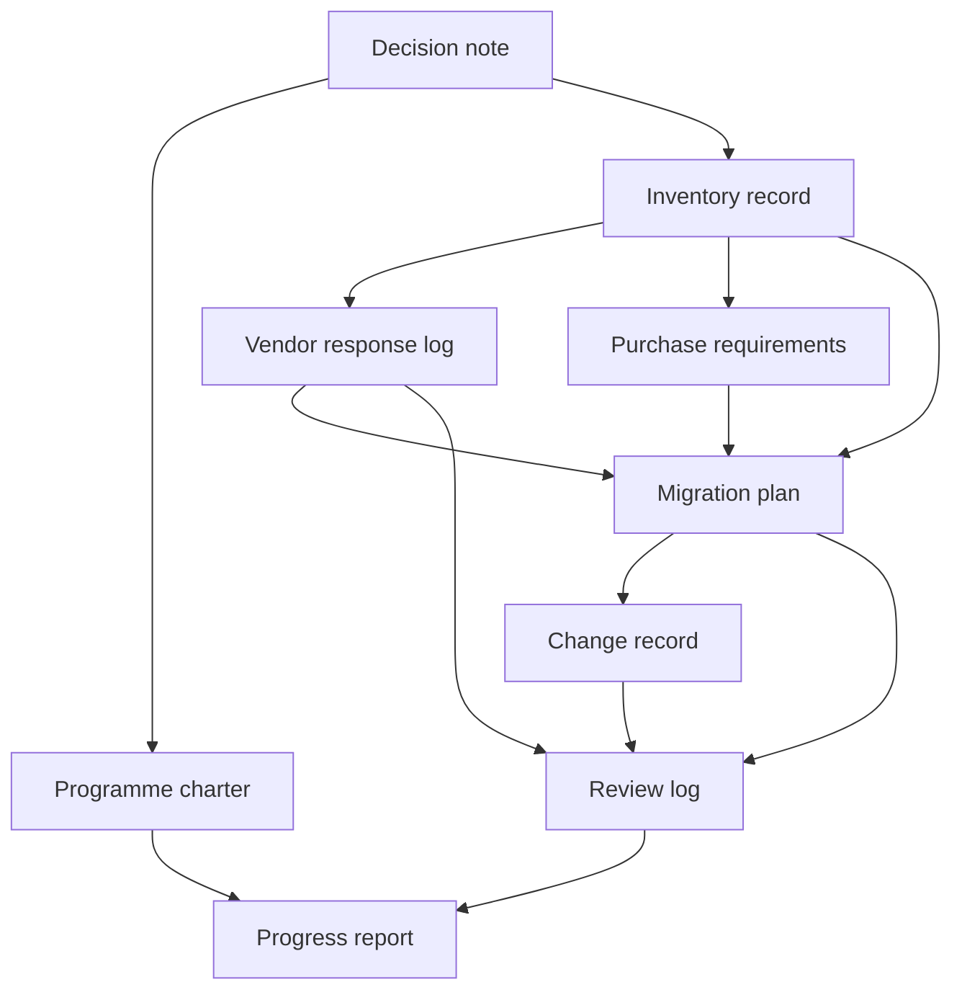

These are the records a migration lead keeps to show what has been decided, asked, required, changed, and reviewed in a post-quantum migration. Each practice and technology card writes to them, and together they are the evidence: when a sponsor, auditor, or customer asks whether a system has migrated, the answer is in these rows, not in a statement. [Protect this first](/resources/protect-this-first/) shows the whole set filled in for one fictional organisation.

You do not need every record on day one. A short-path organisation, running only supported commodity software, keeps the decision note, the inventory, purchase requirements, and the review log; the full path uses all nine.

## The records, in order of use

| Record | Filled by | What it holds | Read next by |
| --- | --- | --- | --- |
| [Decision note](/resources/decision-note/) | [Decide whether to act](/migration-practices/diagnose/) | One row per asset: the four answers, the urgency category, the path, and the sponsor's acceptance | The charter, for assets on the full path; the inventory, for every asset |
| [Programme charter](/resources/programme-charter/) | [Set up the programme](/migration-practices/programme/) | Goal, scope, named roles, first budget line, reporting, and report triggers | Every later record, for owners; the progress report, for its cadence and triggers |
| [Inventory record](/resources/inventory-record/) | [Inventory the cryptography](/migration-practices/inventory/), [Keep commodity software updated](/migration-practices/commodity-software/), and every technology card | One row per asset, with its algorithms for each job, dependencies, what a scan cannot see, and confidence | The migration plan, which orders its assets; the vendor log, for what to ask |
| [Vendor response log](/resources/vendor-response-log/) | [Work with suppliers](/migration-practices/suppliers/) and every technology card | One row per supplier answer, product, version, and job, with the judgement and follow-up | The plan's `supplier readiness`; the review log, for follow-ups |
| [Purchase requirements](/resources/purchase-requirements/) | Work with suppliers, step 5, and the identity, Kerberos, firmware, cloud, and OT cards | One row per purchase or renewal and job: the requirement, the supplier's commitment, and whether it was met | The plan's `next action`; the review log, for any requirement not met |
| [Migration plan](/resources/migration-plan/) | [Decide what to migrate first](/migration-practices/priority/), [Plan the migration](/migration-practices/plan/), and every technology card | One row per asset and job: the order and why, the applicable timeline, the four separate dates, and the next review | The change record, one per change it schedules |
| [Change record](/resources/change-record/) | [Choosing an option](/technology-options/choosing/), [Make and verify one change](/migration-practices/implementation/), and most technology cards | One change to one asset and job: the option and authority, tests, rollback, deployed-state check, and evidence | The inventory and plan, updated with the result; the review log, for what is still open |
| [Review log](/resources/review-log/) | [Review and report](/migration-practices/subsequent-review/) and the technology cards for drafts and exceptions | One row per item reviewed, with its record, asset, job, owner, status, and next review | The progress report; the next review |
| [Progress report](/resources/progress-report/) | Review and report | One report per review: progress per job, what is blocked, milestones at risk, decisions needed, and the sponsor's response | The sponsor; the review log, for any decision taken |

## How the records connect

Three things join the rows:

- **`asset`** is the name the inventory gives each system, service, product, or key. Every row-based record uses the same name, so one asset can be followed from its decision-note row to the sponsor's report. A row that covers several assets lists them separated by semicolons; a review item about the programme as a whole uses `programme`.
- **`job`** is one of `key establishment`, `signatures`, or `non-updatable verifier`, with a qualifier in brackets where one job needs separate work, such as `key establishment (stored data)`. The plan, vendor log, purchase requirements, change record, and review log use these values; the inventory holds one algorithm cell per job instead, and the progress report has one field per job. Keep the jobs on separate rows, because their urgency and coordination differ.
- **`product and version`** joins a supplier answer or purchase requirement to the `version` cell on the inventory, because a supplier's answer applies to a named release.

An `unknown` is carried forward, not filled in with a guess. An `unknown` algorithm leaves the inventory row's `confidence` as `unknown`; a missing supplier answer becomes `missing` on the vendor log and in the plan's `supplier readiness`; a change with no supported option is recorded as `blocked`, with a resolve-by date, on the change record; and each of them stays an `open` item on the review log, with an owner and a next review date, until it is resolved. The progress report lists what is still blocked.

## Rules for every record

- Record `unknown` in any cell you cannot verify yet, and `not applicable` where a job or field does not apply.
- Write dates in record tables as ISO 8601, such as `2026-11-10`.
- Separate several values in one cell with semicolons, labelling each where it helps.
- Keep keys, secrets, and personal data out of the files; name the system only.
- Store the records with the access controls of the asset list they describe, off public tickets and unlocked shared drives.

## Download the set

Each record page has a blank table and a CSV. To set up all nine at once, download [pqc-handbook-records.zip](/downloads/pqc-handbook-records.zip), which holds every blank CSV. The charter and progress report CSVs run down the page as `field,entry` pairs; the others have one header row.

## Starting from a route

Each situation route names the records it produces. Where you start depends on the route:

| Route | Start with |
| --- | --- |
| [Vendor-managed software](/routes/vendor-managed-software/) | Inventory versions, purchase requirements, and the review log |
| [Long-lived confidentiality](/routes/long-lived-confidentiality/) | Inventory, then the migration plan |
| [Hard-to-change systems](/routes/hard-to-change-systems/) | The asset's four dates on the migration plan and its change record, with purchase requirements where a component is still being selected |
| [Organisation-wide](/routes/organisation-wide/) | Programme charter, then every record in order |
| [Ask a supplier](/routes/ask-a-supplier/) | Vendor response log |
| [Not sure](/routes/not-sure/) | Decision note |

## Reference

- [Glossary](/resources/glossary/): plain-language definitions of the terms the records and pages use.
- [Standards](/standards/): summaries of every standard, directive, and migration guide the handbook cites, grouped by their role in the transition, with links to the official texts.

The CISA, NSA, and NIST [Quantum-Readiness fact sheet](/standards/migration-guides/cisa-nsa-nist-fact-sheet/) (as of 17 August 2023) urges organisations to build an inventory of quantum-vulnerable cryptography and to ask technology vendors about it; the inventory and vendor log hold that work.

## Sources

- CISA, NSA, and NIST, Quantum-Readiness fact sheet, as of 17 August 2023. [Fact sheet](https://www.nccoe.nist.gov/sites/default/files/2023-08/quantum-readiness-fact-sheet.pdf)

## Related pages

- [Protect this first](/resources/protect-this-first/)
- [Migration practices](/migration-practices/)
- [Technology options](/technology-options/)
- [Glossary](/resources/glossary/)
