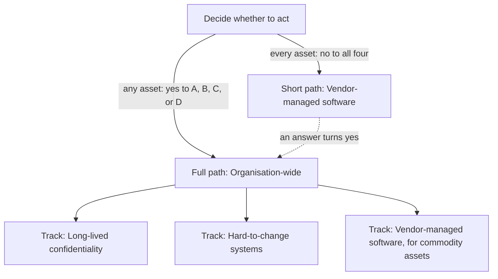

A situation route is a short, ordered path into the practices and records. [Decide whether to act](/migration-practices/diagnose/) holds every rule that chooses a path and a route: its four questions, the table that turns the answers into a path, and the route each asset records on the [decision note](/resources/records/decision-note/). The routes link to those rules and do not restate them. If you have not answered the four questions yet, start there.

## Two paths

| Path | Who it is for, from Decide whether to act | Route | What it produces |
| --- | --- | --- | --- |
| Short | Every asset answers no to all four questions and meets the [five conditions](/migration-practices/diagnose/#five-conditions-for-the-vendor-managed-route) | [Vendor-managed software](/routes/vendor-managed-software/) | Decision note, inventory versions, purchase requirements, a tracking line on the migration plan, the review log, and the progress report |
| Full | Any asset answers yes to question A, B, C, or D | [Organisation-wide](/routes/organisation-wide/) | Programme charter, then every record, with each asset sent to its track |

## Three asset tracks

On the full path, the programme sends each asset to the track its decision-note row records in `route`. [Decide whether to act](/migration-practices/diagnose/), step 3, sets that value, including for an asset that needs two tracks.

| Track, as recorded in `route` | Assets, from Decide whether to act | Clock | Page |
| --- | --- | --- | --- |
| Vendor-managed software | No to all four questions, with the five conditions met | The supplier's release and support dates | [Vendor-managed software](/routes/vendor-managed-software/) |
| Long-lived confidentiality | Yes to question A | The data confidentiality period | [Long-lived confidentiality](/routes/long-lived-confidentiality/) |
| Hard-to-change systems | Yes to question B, C, or D, or a product that fails the fifth condition | Change lead time, relying parties, and verifiers that cannot be updated, each on its own line | [Hard-to-change systems](/routes/hard-to-change-systems/) |

The Vendor-managed software page is both the short path and the track for the commodity part of a full-path estate. The two other tracks each list the deadlines that may apply to their job and the technology cards to open.

The split follows the UK National Cyber Security Centre's [timelines](/standards/migration-guides/uk-ncsc-pqc-guidance/) (published and reviewed 20 March 2025). They are primarily aimed at large organisations, operators of critical national infrastructure, and companies with bespoke IT. They say that for small and medium-sized enterprises using mainly commodity IT, migration should happen seamlessly as services are updated by their vendors. Where custom or specialised software is used, the timelines say it should follow the same timetable as for larger organisations.

## Worked examples

- [Stay on supplier updates](/resources/examples/stay-on-supplier-updates/) follows a fictional marketing agency along the short path.
- [Protect this first](/resources/examples/protect-this-first/) follows a fictional manufacturer along the full path. Its product-design archive is on Long-lived confidentiality. Its sensor's firmware verifier is on Hard-to-change systems. Its office laptops are on Vendor-managed software.

When the answers are still `unknown`, or you cannot choose, follow [When you cannot answer or cannot choose](/migration-practices/diagnose/#when-you-cannot-answer-or-cannot-choose) on Decide whether to act.

## Sources

- UK NCSC, Timelines for migration to post-quantum cryptography, published and reviewed 20 March 2025. [Timelines](https://www.ncsc.gov.uk/guidance/pqc-migration-timelines)

## Related pages

- [Decide whether to act](/migration-practices/diagnose/)
- [Decision note](/resources/records/decision-note/)
- [Migration practices](/migration-practices/)
- [Migration records](/resources/records/)
