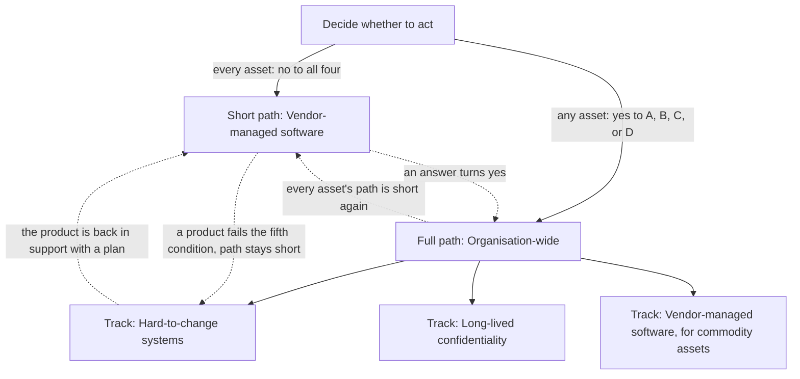

A situation route is a short, ordered path into the practices and records. [Decide whether to act](/migration-practices/diagnose/) holds every rule that chooses a path and a route: its four questions, the table that turns the answers into a path, and the route each asset records on the [decision note](/resources/records/decision-note/). The routes link to those rules; the tables below only point to where each answer leads, and Decide whether to act's wording governs. If you have not answered the four questions yet, start there.

## Two paths

| Path | Who it is for, from Decide whether to act | Route | What it produces |
| --- | --- | --- | --- |
| Short | Every asset's path is short: no to all four questions. Its [five conditions](/migration-practices/diagnose/#five-conditions-for-the-vendor-managed-route) set which route each asset follows | [Vendor-managed software](/routes/vendor-managed-software/) | Decision note, inventory versions, purchase requirements, a tracking line on the migration plan, the review log, and the progress report, plus vendor response log rows for any supplier asked in writing, and the plan dates and change record of any product on Hard-to-change systems |
| Full | Any asset's path is full: yes to question A, B, C, or D | [Organisation-wide](/routes/organisation-wide/) | Programme charter, then every record, with each asset sent to its track |

## Three asset tracks

Each asset follows the track its decision-note row records in `route`; on the full path, the programme sends it there. [Decide whether to act](/migration-practices/diagnose/), step 3, sets that value, including for an asset that needs two tracks.

| Track, as recorded in `route` | Assets, from Decide whether to act | Clock | Page |
| --- | --- | --- | --- |
| Vendor-managed software | No to all four questions, with the five conditions met once checked | The supplier's release and support dates | [Vendor-managed software](/routes/vendor-managed-software/) |
| Long-lived confidentiality | Yes to question A | The data confidentiality period | [Long-lived confidentiality](/routes/long-lived-confidentiality/) |
| Hard-to-change systems | Yes to question B, C, or D, or a product that fails the fifth condition | Change lead time for bespoke systems, relying-party coordination for signatures, and the device's service life for verifiers that cannot be updated, each on its own line, plus replacement lead time for an out-of-support product | [Hard-to-change systems](/routes/hard-to-change-systems/) |

Path is recorded per asset on the decision note, so a full-path organisation can still have assets whose path is short, such as office laptops: they follow Vendor-managed software as a track. That page is therefore both the short path and the track for the commodity part of a full-path estate. The two other tracks each list the deadlines that may apply to their job and the technology cards to open.

The split between the short and full paths is consistent with the UK National Cyber Security Centre's [timelines](/standards/migration-guides/uk-ncsc-pqc-guidance/) (published and reviewed 20 March 2025). They are primarily aimed at technical decision-makers and risk owners in large organisations, operators of critical national infrastructure, and companies with bespoke IT. They say that for small and medium-sized enterprises using mainly commodity IT, migration should happen seamlessly as services are updated by their vendors. Where custom or specialised software is used, the timelines say PQC-compatible updates or replacements need to be identified and deployed, and that this should follow the same timetable as for larger organisations.

## Steps

1. [Decide whether to act](/migration-practices/diagnose/). Record each asset's answers, path, and route on the [decision note](/resources/records/decision-note/), and the first rows on the [inventory record](/resources/records/inventory/).
2. **Follow your path.** On the short path, follow [Vendor-managed software](/routes/vendor-managed-software/). On the full path, follow [Organisation-wide](/routes/organisation-wide/), which starts with [Set up the programme](/migration-practices/programme/) and the [programme charter](/resources/records/programme-charter/).
3. **Take each asset through its track**, as its `route` cell records. Each track page lists the records it fills on the [migration plan](/resources/records/migration-plan/), [vendor response log](/resources/records/vendor-response-log/), [purchase requirements](/resources/records/purchase-requirements/), and [change record](/resources/records/change-record/).
4. [Review and report](/migration-practices/subsequent-review/). Record each review on the [review log](/resources/records/review-log/) and the [progress report](/resources/records/progress-report/), and re-answer the four questions when something changes.

## Output records

All nine [migration records](/resources/records/) come from a route: the short path keeps the set its table row lists, and the full path keeps all nine.

## When to change path or route

- **On the short path, an answer turns yes.** Move to the full path; see [When to leave](/routes/vendor-managed-software/#when-to-leave) on Vendor-managed software.
- **On the short path, a product fails the fifth condition.** Its route changes as Decide whether to act's [five conditions](/migration-practices/diagnose/#five-conditions-for-the-vendor-managed-route) section says.
- **On the full path, every asset's path is short again at a review.** Move to the short path; see [When to leave](/routes/organisation-wide/#when-to-leave) on Organisation-wide.
- **An asset's answers change.** Re-answer the four questions on the decision note; step 3 of Decide whether to act sets the new route.
- **You cannot answer or cannot choose.** Follow [When you cannot answer or cannot choose](/migration-practices/diagnose/#when-you-cannot-answer-or-cannot-choose).

## Worked examples

- [Stay on supplier updates](/resources/examples/stay-on-supplier-updates/) follows a fictional marketing agency along the short path.
- [Protect this first](/resources/examples/protect-this-first/) follows a fictional manufacturer along the full path. Its product-design archive is on Long-lived confidentiality. Its sensor's firmware verifier is on Hard-to-change systems. Its office laptops are on Vendor-managed software.

## Sources

- UK NCSC, Timelines for migration to post-quantum cryptography, published and reviewed 20 March 2025. [Timelines](https://www.ncsc.gov.uk/guidance/pqc-migration-timelines)

## Related pages

- [Decide whether to act](/migration-practices/diagnose/)
- [Decision note](/resources/records/decision-note/)
- [Migration practices](/migration-practices/)
- [Migration records](/resources/records/)
