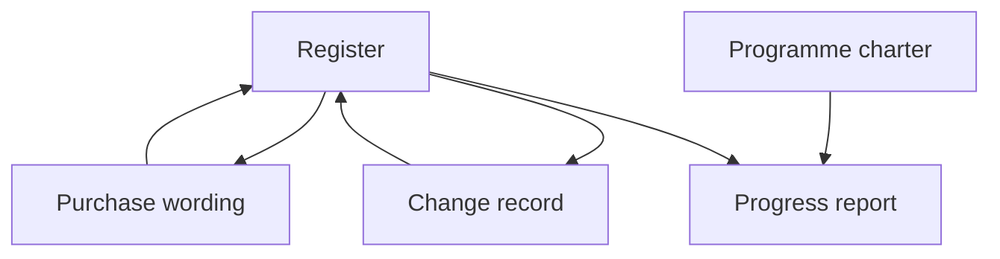

These records show what you have decided, asked, required, changed, and reviewed. When a sponsor, auditor, or customer asks whether a system has migrated, the answer is in these rows, not in a statement.

Most organisations keep only two of them, because an organisation following the [core actions](/plan/core-actions/) needs just the register and the purchase wording. A [programme](/plan/programme/) adds a change record for each change, and a full programme adds the charter and a progress report at each review.

## The records

| Record | Who keeps it | What it holds |
| --- | --- | --- |
| [Register](/templates/records/register/) | Everyone | One row per system and job: why it is on the list, what protects it today, the supplier's answer and its judgement, the dates that apply, the supplier release, testing, production deployment, and end-of-support dates, the order, the next step, status, and the next review |
| [Purchase wording](/templates/records/purchase-wording/) | Everyone who buys or renews | One row per purchase or renewal, job, and supplier: the wording put to the supplier, its commitment, and whether it was met |
| [Programme charter](/templates/records/programme-charter/) | Full programmes | Goal, scope, named roles, first budget line, reporting, and report triggers |
| [Change record](/templates/records/change-record/) | Anyone making a change | One change to one system and job: the option and its authority, tests, rollback, the deployed-state check, and the evidence |
| [Progress report](/templates/records/progress-report/) | Full programmes | One report per review: progress per job, what is blocked, dates at risk, decisions needed, and the sponsor's response |

## How the records connect

Two names join the rows:

- **System** is the name the register gives each system, service, product, or key. Every record uses the same name, so one system can be followed from its register row to the sponsor's report.
- **Job** is key establishment, signatures, or non-updatable verifier, with a qualifier in brackets where one job needs separate work, such as key establishment (stored data). Keep the jobs on separate rows wherever their dates or owners differ, because their clocks differ.

An unknown is carried forward, not filled in with a guess. A missing supplier answer stays missing on the register; a change with no supported option is recorded as blocked, with a date to resolve it; and each stays open, with an owner and a next review, until it is resolved.

## Rules for every record

- Record `unknown` in any cell you cannot verify yet, and `not applicable` where a job or field does not apply.
- Write dates in record tables as ISO 8601, such as `2026-11-10`.
- Separate several values in one cell with semicolons, labelling each where it helps.
- Keep keys, secrets, and personal data out of the files; name the system only.
- Store the records with the access controls of the asset register they describe, off public tickets and unlocked shared drives.

## Download the set

Each record page has a blank table and a CSV. To set up all five at once, download [pqc-handbook-records.zip](/downloads/pqc-handbook-records.zip), which holds every blank CSV. The charter and progress report CSVs run down the page as field and entry pairs; the others have one header row.

## Worked examples

- [Stay on supplier updates](/templates/examples/stay-on-supplier-updates/) fills in the register and purchase wording for a fictional marketing agency following the core actions.
- [Protect this first](/templates/examples/protect-this-first/) fills in all five for a fictional manufacturer running a full programme.

## Sources

The records set out the handbook's own method; the practices that fill them cite their sources.

## Related pages

- [Core actions](/plan/core-actions/)
- [Programme](/plan/programme/)
- [Templates](/templates/)
