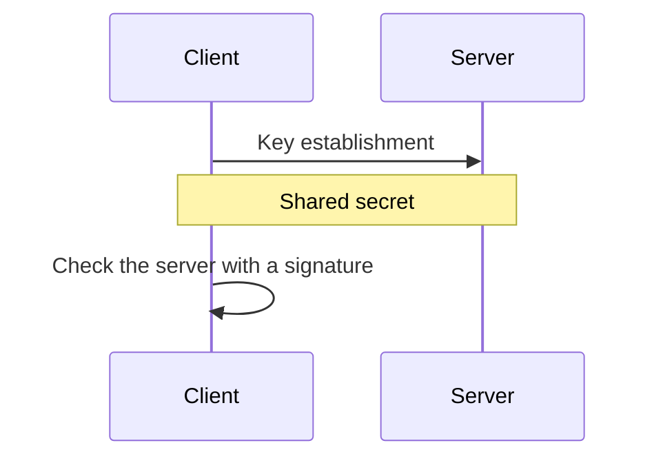
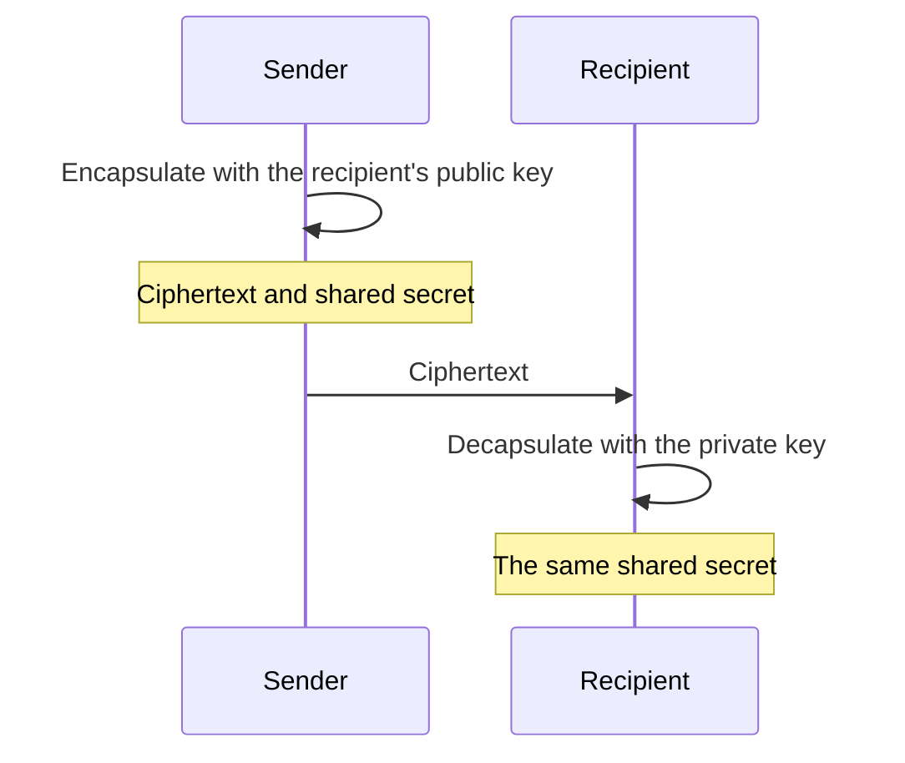
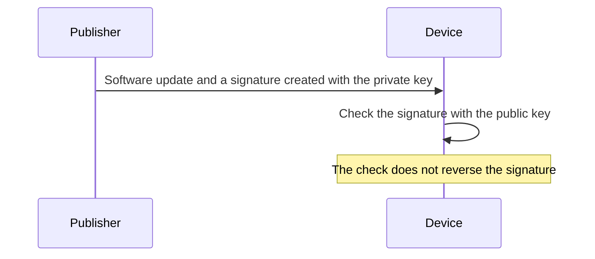

# Explainers Implementation Plan

> **For agentic workers:** REQUIRED SUB-SKILL: Use superpowers:subagent-driven-development (recommended) or superpowers:executing-plans to implement this plan task-by-task. Steps use checkbox (`- [ ]`) syntax for tracking.

**Goal:** Add four optional Learn explainers, with sequence diagrams on three of them, without changing the numbered core path.

**Architecture:** Enable Mermaid in the existing Docusaurus config, then add the pages in reverse link order so each new page links only to a page that already exists. The landing page, sidebar category, and short-lesson sentences land together once all four pages exist.

**Tech Stack:** Docusaurus 3.10.1, `@docusaurus/theme-mermaid` 3.10.1, Mermaid sequence diagrams, Node test runner, existing voice, sources, and records scans.

**Spec:** `planning/superpowers/specs/2026-11-10-explainers-design.md`

## Global Constraints

- Do not commit, push, tag, or otherwise write to git. The skill's commit step does not apply.
- Do not upgrade any `@docusaurus/*` package past 3.10.1. Do not run `npm audit fix`.
- Do not edit clinic rows, CSV headers, the homepage, search config, sitemap config, or robots.
- `last_reviewed` on every new page is `2026-11-10`. Do not change `last_reviewed` on existing pages.
- Body prose is complete sentences in plain British English. A line may use `must` or `shall` only when that same line names an allowed authority (`NCSC`, `NIST`, `FIPS`, `EU`, `NIS`, `ASD`, `ACSC`, `CISA`, `NSA`, `AIVD`, `ETSI`, or `CFDIR`).
- Do not use these phrases: `the clock`, `clocks`, `secrecy life`, `the stack`, `the next pass`, `weak answer`, `stronger answer`, `five responsibilities`, `where to start`, `start here`.
- Diagrams are static `sequenceDiagram` fences only. No image file, no flowchart, no other Mermaid type, no `@mermaid-js/layout-elk`, and no dynamic Mermaid component.
- The quantum page has no `mermaid` fence. The TLS page does not contain the word handshake. The KEM page does not contain `ML-KEM-768` or `parameter set`. No explainer contains the word clinic.
- Do not add an explainer sentence to What post-quantum means, Standardisation, or any practice, route, option, or resource page.
- Do not add a navbar item or a footer link.

## File map

| Task | Files |
| --- | --- |
| 1 | `package.json`, `package-lock.json`, `docusaurus.config.ts`, `scripts/check-explainers.test.mjs` |
| 2 | `docs/learn/explainers/tls.md`, `scripts/check-explainers.test.mjs` |
| 3 | `docs/learn/explainers/kem.md`, `scripts/check-explainers.test.mjs` |
| 4 | `docs/learn/explainers/quantum-computers.md`, `scripts/check-explainers.test.mjs` |
| 5 | `docs/learn/explainers/keys.md`, `scripts/check-explainers.test.mjs` |
| 6 | `docs/learn/index.md`, `docs/learn/public-key-cryptography.md`, `docs/learn/quantum-threat.md`, `docs/learn/algorithms.md`, `docs/learn/in-real-systems.md`, `sidebars.ts`, `navigation-structure.md`, `scripts/check-explainers.test.mjs` |
| 7 | No further copy. Build and browser check. |

---

### Task 1: Mermaid theme

**Files:**
- Modify: `package.json`
- Modify: `package-lock.json`
- Modify: `docusaurus.config.ts`
- Create: `scripts/check-explainers.test.mjs`
- Test: `scripts/check-explainers.test.mjs`

**Interfaces:**
- Consumes: Docusaurus 3.10.1 already in `package.json`
- Produces: `@docusaurus/theme-mermaid` at `3.10.1`, `markdown.mermaid: true`, and `themeConfig.mermaid.theme` of `{light: 'neutral', dark: 'dark'}`. Later tasks use a `mermaid` code fence with no further config.

- [ ] **Step 1: Write the failing test**

Create `scripts/check-explainers.test.mjs`:

```javascript
import test from 'node:test';
import assert from 'node:assert/strict';
import fs from 'node:fs';

const read = (file) => fs.readFileSync(file, 'utf8');

test('mermaid theme is enabled at the Docusaurus 3.10.1 pin', () => {
  const pkg = JSON.parse(read('package.json'));
  assert.equal(pkg.dependencies['@docusaurus/theme-mermaid'], '3.10.1');
  assert.equal(pkg.dependencies['@docusaurus/core'], '3.10.1');
  assert.equal(pkg.dependencies['@docusaurus/preset-classic'], '3.10.1');
  assert.equal(pkg.dependencies['@docusaurus/faster'], '3.10.1');
  assert.match(pkg.scripts.test, /scripts\/check-explainers\.test\.mjs/);
  assert.equal(pkg.dependencies['@mermaid-js/layout-elk'], undefined);
  const config = read('docusaurus.config.ts');
  assert.match(config, /mermaid:\s*true/);
  assert.match(config, /@docusaurus\/theme-mermaid/);
  assert.match(config, /light:\s*'neutral'/);
  assert.match(config, /dark:\s*'dark'/);
  assert.equal(config.includes('layout-elk'), false);
  assert.equal(config.includes('@theme/Mermaid'), false);
});
```

- [ ] **Step 2: Run the test to verify it fails**

Run: `node --test scripts/check-explainers.test.mjs`

Expected: FAIL because `@docusaurus/theme-mermaid` is missing.

- [ ] **Step 3: Install the theme and enable it**

Run: `npm install --save --save-exact @docusaurus/theme-mermaid@3.10.1`

The install needs network access. If it changes `@docusaurus/core`, `@docusaurus/preset-classic`, or `@docusaurus/faster` away from `3.10.1`, put those three versions back to `3.10.1` before continuing.

In `package.json`, the `test` script becomes:

```json
"test": "node --test scripts/check-voice.test.mjs scripts/check-sources.test.mjs scripts/check-records.test.mjs scripts/check-clinic.test.mjs scripts/check-explainers.test.mjs"
```

In `docusaurus.config.ts`, replace the markdown field with:

```ts
  markdown: {
    mermaid: true,
    hooks: {onBrokenMarkdownLinks: 'throw'},
  },
```

Replace the `themes` array with:

```ts
  themes: [
    '@docusaurus/theme-mermaid',
    [
      require.resolve('@easyops-cn/docusaurus-search-local'),
      {
        hashed: true,
        language: ['en'],
        indexDocs: true,
        indexBlog: false,
        docsRouteBasePath: '/',
      },
    ],
  ],
```

Replace the closing of `themeConfig` so the existing `prism` field stays and `mermaid` is added:

```ts
    prism: {theme: prismThemes.github, darkTheme: prismThemes.dracula},
    mermaid: {
      theme: {light: 'neutral', dark: 'dark'},
    },
  } satisfies Preset.ThemeConfig & {
    mermaid: {theme: {light: 'neutral'; dark: 'dark'}};
  },
```

- [ ] **Step 4: Run the test and the typecheck**

Run: `npm test && npm run typecheck`

Expected: the existing tests and the new Mermaid test pass, and `tsc` exits 0.

- [ ] **Step 5: Do not commit**

Leave the working tree dirty.

---

### Task 2: TLS explainer

**Files:**
- Create: `docs/learn/explainers/tls.md`
- Modify: `scripts/check-explainers.test.mjs`
- Test: `scripts/check-explainers.test.mjs`

**Interfaces:**
- Consumes: Mermaid enabled in Task 1. Existing pages `/learn/in-real-systems/` and `/learn/`.
- Produces: `/learn/explainers/tls/` for the KEM page's next link. The page contains no handshake wording.

- [ ] **Step 1: Replace the test file with the failing TLS coverage**

Replace `scripts/check-explainers.test.mjs` with:

```javascript
import test from 'node:test';
import assert from 'node:assert/strict';
import fs from 'node:fs';

const read = (file) => fs.readFileSync(file, 'utf8');

test('mermaid theme is enabled at the Docusaurus 3.10.1 pin', () => {
  const pkg = JSON.parse(read('package.json'));
  assert.equal(pkg.dependencies['@docusaurus/theme-mermaid'], '3.10.1');
  assert.equal(pkg.dependencies['@docusaurus/core'], '3.10.1');
  assert.equal(pkg.dependencies['@docusaurus/preset-classic'], '3.10.1');
  assert.equal(pkg.dependencies['@docusaurus/faster'], '3.10.1');
  assert.match(pkg.scripts.test, /scripts\/check-explainers\.test\.mjs/);
  assert.equal(pkg.dependencies['@mermaid-js/layout-elk'], undefined);
  const config = read('docusaurus.config.ts');
  assert.match(config, /mermaid:\s*true/);
  assert.match(config, /@docusaurus\/theme-mermaid/);
  assert.match(config, /light:\s*'neutral'/);
  assert.match(config, /dark:\s*'dark'/);
  assert.equal(config.includes('layout-elk'), false);
  assert.equal(config.includes('@theme/Mermaid'), false);
});

test('tls explainer separates the shared secret from the server check', () => {
  const page = read('docs/learn/explainers/tls.md');
  assert.match(page, /displayed_sidebar: learnSidebar/);
  assert.match(page, /last_reviewed: 2026-11-10/);
  assert.match(page, /Where is the shared secret established in a TLS connection, and how is that different from checking who the server is\?/);
  assert.match(page, /reader who has read \[In real systems\]\(\/learn\/in-real-systems\/\)/);
  assert.match(page, /It gives no client setting, no cipher list, and no byte-level exchange\./);
  assert.match(page, /sequenceDiagram[\s\S]*participant Client[\s\S]*participant Server[\s\S]*Key establishment[\s\S]*Check the server with a signature/);
  assert.match(page, /\| Classical \| Today's public-key key establishment \| A separate signature check \|/);
  assert.match(page, /\| Hybrid \| A classical key establishment and a post-quantum key establishment used together \| A separate signature check \|/);
  assert.match(page, /\| Post-quantum-only \| Post-quantum key establishment alone \| A separate signature check \|/);
  assert.match(page, /\*\*Authority recommendation:\*\* \[NIST IR 8547\]\(https:\/\/doi\.org\/10\.6028\/NIST\.IR\.8547\), October 2026, treats a hybrid construction as a temporary hedge\./);
  assert.match(page, /https:\/\/www\.ncsc\.gov\.uk\/guidance\/pqc-migration-timelines/);
  assert.match(page, /an exact industry-wide mechanism was not yet standardised at publication/);
  assert.match(page, /modified 3 August 2026/);
  assert.match(page, /Key establishment produces the shared secret\. Checking the server is a separate signature check\. That split holds for a classical exchange, a hybrid exchange, and a post-quantum-only exchange\./);
  assert.match(page, /This distinction continues from \[In real systems\]\(\/learn\/in-real-systems\/\)\./);
  assert.match(page, /Next: \[Learn the basics\]\(\/learn\/\)\./);
  assert.equal(page.toLowerCase().includes('handshake'), false);
  assert.equal(page.includes('ML-KEM-768'), false);
  assert.equal(page.toLowerCase().includes('clinic'), false);
  assert.equal(page.includes('!['), false);
  assert.equal(page.includes('RFC 10024'), false);
});
```

- [ ] **Step 2: Run the test to verify it fails**

Run: `node --test scripts/check-explainers.test.mjs`

Expected: FAIL while reading `docs/learn/explainers/tls.md`, because that file does not exist. The Mermaid test still passes.

- [ ] **Step 3: Write the page**

Create `docs/learn/explainers/tls.md`:

````markdown
---
title: What changes in a TLS connection
sidebar_label: What changes in a TLS connection
description: Where the shared secret is established in a TLS connection, and how that differs from checking who the server is.
displayed_sidebar: learnSidebar
last_reviewed: 2026-11-10
---

Where is the shared secret established in a TLS connection, and how is that different from checking who the server is?

This page is for a reader who has read [In real systems](/learn/in-real-systems/) and wants one further distinction. That lesson places key establishment in TLS sessions. This page separates the shared secret from the check of who the server is. It gives no client setting, no cipher list, and no byte-level exchange.

The figure shows one connection. Key establishment produces the shared secret. Checking the server is a separate signature check.



**Handbook explanation:**

| Exchange | What establishes the shared secret | What still authenticates the server |
| --- | --- | --- |
| Classical | Today's public-key key establishment | A separate signature check |
| Hybrid | A classical key establishment and a post-quantum key establishment used together | A separate signature check |
| Post-quantum-only | Post-quantum key establishment alone | A separate signature check |

**Authority recommendation:** [NIST IR 8547](https://doi.org/10.6028/NIST.IR.8547), October 2026, treats a hybrid construction as a temporary hedge.

**Authority recommendation:** The [UK NCSC timelines](https://www.ncsc.gov.uk/guidance/pqc-migration-timelines), modified 3 August 2026, note that popular browsers can agree a post-quantum key using a hybrid of traditional key exchange and ML-KEM, and that an exact industry-wide mechanism was not yet standardised at publication, so further updates can be expected.

Key establishment produces the shared secret. Checking the server is a separate signature check. That split holds for a classical exchange, a hybrid exchange, and a post-quantum-only exchange.

This distinction continues from [In real systems](/learn/in-real-systems/).

Next: [Learn the basics](/learn/).

## Sources

- NIST IR 8547, Transition to Post-Quantum Cryptography Standards, October 2026. [NIST IR 8547](https://doi.org/10.6028/NIST.IR.8547)
- UK NCSC, Post-quantum cryptography migration timelines, modified 3 August 2026. [UK NCSC timelines](https://www.ncsc.gov.uk/guidance/pqc-migration-timelines)
````

- [ ] **Step 4: Run the checks and the build**

Run: `npm test && npm run check:voice && npm run check:sources && npm run check:records && npm run build`

Expected: all four commands exit 0.

- [ ] **Step 5: Do not commit**

Leave the working tree dirty.

---

### Task 3: KEM explainer

**Files:**
- Create: `docs/learn/explainers/kem.md`
- Modify: `scripts/check-explainers.test.mjs`
- Test: `scripts/check-explainers.test.mjs`

**Interfaces:**
- Consumes: `/learn/explainers/tls/` from Task 2, and `/learn/algorithms/`.
- Produces: `/learn/explainers/kem/` for the quantum page's next link. The page names ML-KEM and does not name ML-KEM-768.

- [ ] **Step 1: Add the failing KEM test**

Append this test to `scripts/check-explainers.test.mjs` after the TLS test. Leave the earlier tests in place.

```javascript
test('kem explainer stops at the shared secret', () => {
  const page = read('docs/learn/explainers/kem.md');
  assert.match(page, /displayed_sidebar: learnSidebar/);
  assert.match(page, /last_reviewed: 2026-11-10/);
  assert.match(page, /What does a key-encapsulation mechanism produce, and why is that not bulk encryption\?/);
  assert.match(page, /reader who has read \[Algorithms\]\(\/learn\/algorithms\/\)/);
  assert.match(page, /The KEM does not carry the page, the file, or the health record\./);
  assert.match(page, /unnamed example of bulk data/);
  assert.match(page, /sequenceDiagram[\s\S]*participant Sender[\s\S]*participant Recipient[\s\S]*Encapsulate with the recipient's public key[\s\S]*Decapsulate with the private key/);
  assert.match(page, /Encapsulation produces a ciphertext and a shared secret\. Decapsulation recovers that secret\. The KEM does not carry the page, the file, or the health record\./);
  assert.match(page, /This distinction continues from \[Algorithms\]\(\/learn\/algorithms\/\)\./);
  assert.match(page, /Next: \[What changes in a TLS connection\]\(\/learn\/explainers\/tls\/\)\./);
  assert.match(page, /https:\/\/csrc\.nist\.gov\/pubs\/fips\/203\/final/);
  assert.match(page, /for ML-KEM/);
  assert.equal(page.includes('ML-KEM-768'), false);
  assert.equal(page.includes('parameter set'), false);
  assert.equal(page.toLowerCase().includes('clinic'), false);
  assert.equal(page.includes('!['), false);
});
```

- [ ] **Step 2: Run the test to verify it fails**

Run: `node --test scripts/check-explainers.test.mjs`

Expected: FAIL while reading `docs/learn/explainers/kem.md`. The Mermaid and TLS tests still pass.

- [ ] **Step 3: Write the page**

Create `docs/learn/explainers/kem.md`:

````markdown
---
title: What a KEM is
sidebar_label: What a KEM is
description: What a key-encapsulation mechanism produces, and why that is not bulk encryption.
displayed_sidebar: learnSidebar
last_reviewed: 2026-11-10
---

What does a key-encapsulation mechanism produce, and why is that not bulk encryption?

This page is for a reader who has read [Algorithms](/learn/algorithms/) and wants one further distinction. That lesson describes encapsulation and decapsulation. This page shows that the result is a shared secret, not the page or the file.

One party encapsulates with the other's public key and produces a ciphertext and a shared secret. The other decapsulates with the private key and recovers the same secret. A protocol such as TLS then derives symmetric keys from that secret, and those keys protect the bulk of the traffic. The KEM does not carry the page, the file, or the health record. The health record here is an unnamed example of bulk data.

The figure shows encapsulation and decapsulation between two parties.



The KEM does not carry the page, the file, or the health record.

Encapsulation produces a ciphertext and a shared secret. Decapsulation recovers that secret. The KEM does not carry the page, the file, or the health record.

This distinction continues from [Algorithms](/learn/algorithms/).

Next: [What changes in a TLS connection](/learn/explainers/tls/).

## Sources

- NIST, FIPS 203, Module-Lattice-Based Key-Encapsulation Mechanism, for ML-KEM. [FIPS 203](https://csrc.nist.gov/pubs/fips/203/final)
- NIST IR 8547, Transition to Post-Quantum Cryptography Standards, October 2026, for that pattern of use. [NIST IR 8547](https://doi.org/10.6028/NIST.IR.8547)
````

- [ ] **Step 4: Run the checks and the build**

Run: `npm test && npm run check:voice && npm run check:sources && npm run check:records && npm run build`

Expected: all four commands exit 0.

- [ ] **Step 5: Do not commit**

Leave the working tree dirty.

---

### Task 4: Quantum-computer explainer

**Files:**
- Create: `docs/learn/explainers/quantum-computers.md`
- Modify: `scripts/check-explainers.test.mjs`
- Test: `scripts/check-explainers.test.mjs`

**Interfaces:**
- Consumes: `/learn/explainers/kem/` from Task 3, and `/learn/quantum-threat/`.
- Produces: `/learn/explainers/quantum-computers/` for the keys page's next link. The page has no diagram.

- [ ] **Step 1: Add the failing quantum test**

Append this test to `scripts/check-explainers.test.mjs`. Leave the earlier tests in place.

```javascript
test('quantum explainer keeps the contrast inside NIST IR 8547', () => {
  const page = read('docs/learn/explainers/quantum-computers.md');
  assert.match(page, /displayed_sidebar: learnSidebar/);
  assert.match(page, /last_reviewed: 2026-11-10/);
  assert.match(page, /Which quantum effect applies to confidentiality, and which does not\?/);
  assert.match(page, /reader who has read \[The quantum threat\]\(\/learn\/quantum-threat\/\)/);
  assert.match(page, /names Shor's algorithm as the quantum algorithm that threatens today's public-key key establishment and digital signatures/);
  assert.match(page, /names Grover's algorithm as the more limited effect, which does not by itself retire symmetric cryptography on the same timetable/);
  assert.match(page, /confidentiality risk for information protected now and still sensitive later/);
  assert.match(page, /a signature checked at the time of use is not that confidentiality risk/);
  assert.match(page, /This page does not say that a cryptographically relevant quantum computer already exists\./);
  assert.match(page, /\| Information protected now and still sensitive later \| Harvest-now, decrypt-later, a confidentiality risk \|/);
  assert.match(page, /\| A signature checked at the time of use \| Not that confidentiality risk \|/);
  assert.match(page, /The right-hand column is an \*\*Authority statement\*\*, cited to NIST IR 8547, October 2026\./);
  assert.match(page, /Shor's algorithm applies to today's public-key key establishment and digital signatures\. Grover's algorithm does not by itself retire symmetric cryptography on the same timetable\. Harvest-now, decrypt-later is a confidentiality risk, and a signature checked at the time of use is not that risk\./);
  assert.match(page, /This distinction continues from \[The quantum threat\]\(\/learn\/quantum-threat\/\)\./);
  assert.match(page, /Next: \[What a KEM is\]\(\/learn\/explainers\/kem\/\)\./);
  assert.match(page, /https:\/\/doi\.org\/10\.6028\/NIST\.IR\.8547/);
  assert.equal(page.includes('mermaid'), false);
  assert.equal(page.includes('sequenceDiagram'), false);
  assert.equal(page.includes('fips/203'), false);
  assert.equal(page.includes('ncsc.gov.uk'), false);
  assert.equal(page.toLowerCase().includes('clinic'), false);
  assert.equal(page.includes('!['), false);
});
```

- [ ] **Step 2: Run the test to verify it fails**

Run: `node --test scripts/check-explainers.test.mjs`

Expected: FAIL while reading `docs/learn/explainers/quantum-computers.md`. The earlier tests still pass.

- [ ] **Step 3: Write the page**

Create `docs/learn/explainers/quantum-computers.md`. The right-hand-column sentence must match the test: "The right-hand column is an **Authority statement**, cited to NIST IR 8547, October 2026."

````markdown
---
title: What a quantum computer changes
sidebar_label: What a quantum computer changes
description: Which quantum effect applies to confidentiality, and which does not.
displayed_sidebar: learnSidebar
last_reviewed: 2026-11-10
---

Which quantum effect applies to confidentiality, and which does not?

This page is for a reader who has read [The quantum threat](/learn/quantum-threat/) and wants one further distinction. That lesson names the quantum algorithms and the confidentiality risk. This page separates that risk from a signature checked at the time of use.

**Authority statement:** [NIST IR 8547](https://doi.org/10.6028/NIST.IR.8547), October 2026, names Shor's algorithm as the quantum algorithm that threatens today's public-key key establishment and digital signatures.

**Authority statement:** [NIST IR 8547](https://doi.org/10.6028/NIST.IR.8547), October 2026, names Grover's algorithm as the more limited effect, which does not by itself retire symmetric cryptography on the same timetable.

**Authority statement:** [NIST IR 8547](https://doi.org/10.6028/NIST.IR.8547), October 2026, describes harvest-now, decrypt-later as a confidentiality risk for information protected now and still sensitive later.

**Authority statement:** [NIST IR 8547](https://doi.org/10.6028/NIST.IR.8547), October 2026, states that a signature checked at the time of use is not that confidentiality risk.

This page does not say that a cryptographically relevant quantum computer already exists.

**Handbook explanation:** the rows below set the confidentiality risk beside a signature checked at the time of use. The right-hand column is an **Authority statement**, cited to NIST IR 8547, October 2026.

| What is under consideration | What applies |
| --- | --- |
| Information protected now and still sensitive later | Harvest-now, decrypt-later, a confidentiality risk |
| A signature checked at the time of use | Not that confidentiality risk |

Shor's algorithm applies to today's public-key key establishment and digital signatures. Grover's algorithm does not by itself retire symmetric cryptography on the same timetable. Harvest-now, decrypt-later is a confidentiality risk, and a signature checked at the time of use is not that risk.

This distinction continues from [The quantum threat](/learn/quantum-threat/).

Next: [What a KEM is](/learn/explainers/kem/).

## Sources

- NIST IR 8547, Transition to Post-Quantum Cryptography Standards, October 2026. [NIST IR 8547](https://doi.org/10.6028/NIST.IR.8547)
````

- [ ] **Step 4: Run the checks and the build**

Run: `npm test && npm run check:voice && npm run check:sources && npm run check:records && npm run build`

Expected: all four commands exit 0.

- [ ] **Step 5: Do not commit**

Leave the working tree dirty.

---

### Task 5: Keys explainer

**Files:**
- Create: `docs/learn/explainers/keys.md`
- Modify: `scripts/check-explainers.test.mjs`
- Test: `scripts/check-explainers.test.mjs`

**Interfaces:**
- Consumes: `/learn/explainers/quantum-computers/` from Task 4, and `/learn/public-key-cryptography/`.
- Produces: `/learn/explainers/keys/`. The page names no algorithm.

- [ ] **Step 1: Add the failing keys test**

Append this test to `scripts/check-explainers.test.mjs`. Leave the earlier tests in place.

```javascript
test('keys explainer assigns each job to a key', () => {
  const page = read('docs/learn/explainers/keys.md');
  assert.match(page, /displayed_sidebar: learnSidebar/);
  assert.match(page, /last_reviewed: 2026-11-10/);
  assert.match(page, /Which job does the public key do, and which job does the private key do\?/);
  assert.match(page, /reader who has read \[Public-key cryptography\]\(\/learn\/public-key-cryptography\/\)/);
  assert.match(page, /\| Key establishment \| Used to create a shared secret \| Recovers that secret \|/);
  assert.match(page, /\| Encryption \| Encrypts \| Decrypts \|/);
  assert.match(page, /\| Signing \| Checks the signature \| Creates the signature \|/);
  assert.match(page, /\| Verification \| The check itself \| Does not reverse the signature \|/);
  assert.match(page, /The encryption row is a handbook explanation of that classical job\./);
  assert.match(page, /does not claim that FIPS 203, FIPS 204, or FIPS 205 standardises public-key encryption/);
  assert.match(page, /An unnamed web session uses key establishment\./);
  assert.match(page, /An unnamed software update uses signing and verification\./);
  assert.match(page, /sequenceDiagram[\s\S]*participant Publisher[\s\S]*participant Device[\s\S]*The check does not reverse the signature/);
  assert.match(page, /The public key is used to create a shared secret, and the private key recovers it\. The private key creates a signature, and the public key checks it\. Checking a signature does not reverse it\./);
  assert.match(page, /This distinction continues from \[Public-key cryptography\]\(\/learn\/public-key-cryptography\/\)\./);
  assert.match(page, /Next: \[What a quantum computer changes\]\(\/learn\/explainers\/quantum-computers\/\)\./);
  assert.match(page, /https:\/\/doi\.org\/10\.6028\/NIST\.IR\.8547/);
  assert.match(page, /https:\/\/csrc\.nist\.gov\/pubs\/fips\/203\/final/);
  assert.match(page, /https:\/\/csrc\.nist\.gov\/pubs\/fips\/204\/final/);
  assert.match(page, /https:\/\/csrc\.nist\.gov\/pubs\/fips\/205\/final/);
  assert.equal(page.includes('ML-KEM'), false);
  assert.equal(page.includes('RSA'), false);
  assert.equal(page.toLowerCase().includes('clinic'), false);
  assert.equal(page.includes('!['), false);
});
```

- [ ] **Step 2: Run the test to verify it fails**

Run: `node --test scripts/check-explainers.test.mjs`

Expected: FAIL while reading `docs/learn/explainers/keys.md`. The earlier tests still pass.

- [ ] **Step 3: Write the page**

Create `docs/learn/explainers/keys.md`:

````markdown
---
title: What the keys actually do
sidebar_label: What the keys actually do
description: Which job the public key does, and which job the private key does.
displayed_sidebar: learnSidebar
last_reviewed: 2026-11-10
---

Which job does the public key do, and which job does the private key do?

This page is for a reader who has read [Public-key cryptography](/learn/public-key-cryptography/) and wants one further distinction. That lesson says the two keys do different jobs. This page sets the jobs side by side.

**Handbook explanation:**

| Job | What the public key does | What the private key does |
| --- | --- | --- |
| Key establishment | Used to create a shared secret | Recovers that secret |
| Encryption | Encrypts | Decrypts |
| Signing | Checks the signature | Creates the signature |
| Verification | The check itself | Does not reverse the signature |

The encryption row is a handbook explanation of that classical job. This page does not claim that FIPS 203, FIPS 204, or FIPS 205 standardises public-key encryption.

An unnamed web session uses key establishment. An unnamed software update uses signing and verification. This page names no algorithm.

The figure shows that software update. The publisher signs it with the private key, and the device checks it with the public key.



The public key is used to create a shared secret, and the private key recovers it. The private key creates a signature, and the public key checks it. Checking a signature does not reverse it.

This distinction continues from [Public-key cryptography](/learn/public-key-cryptography/).

Next: [What a quantum computer changes](/learn/explainers/quantum-computers/).

## Sources

- NIST, Transition to Post-Quantum Cryptography Standards (NIST IR 8547), October 2026, for the public-key jobs that report names. [NIST IR 8547](https://doi.org/10.6028/NIST.IR.8547)
- FIPS 203 for post-quantum key establishment. [FIPS 203](https://csrc.nist.gov/pubs/fips/203/final)
- FIPS 204 for post-quantum signatures. [FIPS 204](https://csrc.nist.gov/pubs/fips/204/final)
- FIPS 205 for post-quantum signatures. [FIPS 205](https://csrc.nist.gov/pubs/fips/205/final)
````

- [ ] **Step 4: Run the checks and the build**

Run: `npm test && npm run check:voice && npm run check:sources && npm run check:records && npm run build`

Expected: all four commands exit 0.

- [ ] **Step 5: Do not commit**

Leave the working tree dirty.

---

### Task 6: Go deeper placement

**Files:**
- Modify: `docs/learn/index.md`
- Modify: `docs/learn/public-key-cryptography.md`
- Modify: `docs/learn/quantum-threat.md`
- Modify: `docs/learn/algorithms.md`
- Modify: `docs/learn/in-real-systems.md`
- Modify: `sidebars.ts`
- Modify: `navigation-structure.md`
- Modify: `scripts/check-explainers.test.mjs`
- Test: `scripts/check-explainers.test.mjs`

**Interfaces:**
- Consumes: the four explainer paths from Tasks 2 to 5.
- Produces: the Learn landing section, the sidebar category, and the four short-lesson sentences. No other docs page links to `/learn/explainers/`.

- [ ] **Step 1: Add the failing placement tests**

Append these tests to `scripts/check-explainers.test.mjs`. Leave the earlier tests in place.

```javascript
import path from 'node:path';

function walk(dir) {
  const found = [];
  for (const entry of fs.readdirSync(dir, {withFileTypes: true})) {
    const full = path.join(dir, entry.name);
    if (entry.isDirectory()) found.push(...walk(full));
    else if (entry.name.endsWith('.md')) found.push(full);
  }
  return found;
}

test('go deeper lists the four explainers without changing the core path', () => {
  const landing = read('docs/learn/index.md');
  assert.match(landing, /1\. \[Public key cryptography\]\(\/learn\/public-key-cryptography\/\)/);
  assert.match(landing, /2\. \[Quantum threat\]\(\/learn\/quantum-threat\/\)/);
  assert.match(landing, /3\. \[What post-quantum means\]\(\/learn\/what-post-quantum-means\/\)/);
  assert.match(landing, /4\. \[Algorithms\]\(\/learn\/algorithms\/\)/);
  assert.match(landing, /5\. \[In real systems\]\(\/learn\/in-real-systems\/\)/);
  assert.match(landing, /6\. \[Standardisation\]\(\/learn\/standardisation\/\)/);
  assert.match(landing, /7\. \[Glossary\]\(\/resources\/glossary\/\)/);
  assert.match(landing, /This path does not give a migration procedure\./);
  const deeperAt = landing.indexOf('## Go deeper');
  const planAt = landing.indexOf('When you are ready to plan');
  assert.ok(deeperAt > -1 && planAt > deeperAt);
  const deeper = landing.slice(deeperAt, planAt);
  assert.match(deeper, /These pages are optional\./);
  assert.match(deeper, /1\. \[What the keys actually do\]\(\/learn\/explainers\/keys\/\)/);
  assert.match(deeper, /2\. \[What a quantum computer changes\]\(\/learn\/explainers\/quantum-computers\/\)/);
  assert.match(deeper, /3\. \[What a KEM is\]\(\/learn\/explainers\/kem\/\)/);
  assert.match(deeper, /4\. \[What changes in a TLS connection\]\(\/learn\/explainers\/tls\/\)/);

  const publicKey = read('docs/learn/public-key-cryptography.md');
  assert.match(publicKey, /Next: \[The quantum threat\]\(\/learn\/quantum-threat\/\)\.\n\nFor how the two keys differ by job, read \[What the keys actually do\]\(\/learn\/explainers\/keys\/\)\./);
  const quantum = read('docs/learn/quantum-threat.md');
  assert.match(quantum, /Next: \[What post-quantum means\]\(\/learn\/what-post-quantum-means\/\)\.\n\nFor which quantum effect applies to confidentiality, read \[What a quantum computer changes\]\(\/learn\/explainers\/quantum-computers\/\)\./);
  const algorithms = read('docs/learn/algorithms.md');
  assert.match(algorithms, /Next: \[In real systems\]\(\/learn\/in-real-systems\/\)\.\n\nFor why a KEM is not bulk encryption, read \[What a KEM is\]\(\/learn\/explainers\/kem\/\)\./);
  const systems = read('docs/learn/in-real-systems.md');
  assert.match(systems, /Next: \[Standardisation\]\(\/learn\/standardisation\/\)\.\n\nFor where the shared secret sits in a connection, read \[What changes in a TLS connection\]\(\/learn\/explainers\/tls\/\)\./);

  const sidebars = read('sidebars.ts');
  const categoryAt = sidebars.indexOf("label: 'Go deeper'");
  assert.ok(categoryAt > sidebars.indexOf("'learn/standardisation'"));
  assert.match(sidebars, /collapsed: false/);
  const category = sidebars.slice(categoryAt);
  const keysAt = category.indexOf("'learn/explainers/keys'");
  const quantumAt = category.indexOf("'learn/explainers/quantum-computers'");
  const kemAt = category.indexOf("'learn/explainers/kem'");
  const tlsAt = category.indexOf("'learn/explainers/tls'");
  assert.ok(keysAt > -1 && keysAt < quantumAt && quantumAt < kemAt && kemAt < tlsAt);

  const nav = read('navigation-structure.md');
  assert.match(nav, /\/learn\/explainers\/keys\//);
  assert.match(nav, /\/learn\/explainers\/quantum-computers\//);
  assert.match(nav, /\/learn\/explainers\/kem\//);
  assert.match(nav, /\/learn\/explainers\/tls\//);
  assert.match(nav, /The learn landing lists six lessons; the glossary on the resources sidebar is the seventh step in the sequence\. Go deeper is an optional list of four explainers on the Learn landing page and in `learnSidebar`\./);
});

test('explainer links stay on the learn path', () => {
  const allowed = new Set([
    'docs/learn/index.md',
    'docs/learn/public-key-cryptography.md',
    'docs/learn/quantum-threat.md',
    'docs/learn/algorithms.md',
    'docs/learn/in-real-systems.md',
    'docs/learn/explainers/keys.md',
    'docs/learn/explainers/quantum-computers.md',
    'docs/learn/explainers/kem.md',
    'docs/learn/explainers/tls.md',
  ]);
  const leaks = walk('docs')
    .map((file) => file.split(path.sep).join('/'))
    .filter((file) => read(file).includes('/learn/explainers/') && !allowed.has(file));
  assert.deepEqual(leaks, []);
});
```

The `import path` line goes at the top of the file with the other imports. Do not leave a second import in the middle of the file. `walk` goes next to `read`.

- [ ] **Step 2: Run the test to verify it fails**

Run: `node --test scripts/check-explainers.test.mjs`

Expected: FAIL on the missing `## Go deeper` section. The page tests still pass.

- [ ] **Step 3: Add the landing section, the lesson sentences, the sidebar, and the book map**

In `docs/learn/index.md`, replace:

```markdown
This path does not give a migration procedure.

When you are ready to plan, return to the [homepage](/) or browse [curated references](/resources/curated-references/).
```

with:

```markdown
This path does not give a migration procedure.

## Go deeper

These pages are optional.

1. [What the keys actually do](/learn/explainers/keys/)
2. [What a quantum computer changes](/learn/explainers/quantum-computers/)
3. [What a KEM is](/learn/explainers/kem/)
4. [What changes in a TLS connection](/learn/explainers/tls/)

When you are ready to plan, return to the [homepage](/) or browse [curated references](/resources/curated-references/).
```

In `docs/learn/public-key-cryptography.md`, replace the next line with:

```markdown
Next: [The quantum threat](/learn/quantum-threat/).

For how the two keys differ by job, read [What the keys actually do](/learn/explainers/keys/).
```

In `docs/learn/quantum-threat.md`, replace the next line with:

```markdown
Next: [What post-quantum means](/learn/what-post-quantum-means/).

For which quantum effect applies to confidentiality, read [What a quantum computer changes](/learn/explainers/quantum-computers/).
```

In `docs/learn/algorithms.md`, replace the next line with:

```markdown
Next: [In real systems](/learn/in-real-systems/).

For why a KEM is not bulk encryption, read [What a KEM is](/learn/explainers/kem/).
```

In `docs/learn/in-real-systems.md`, replace the next line with:

```markdown
Next: [Standardisation](/learn/standardisation/).

For where the shared secret sits in a connection, read [What changes in a TLS connection](/learn/explainers/tls/).
```

In `sidebars.ts`, replace `learnSidebar` with:

```ts
  learnSidebar: [
    'learn/index',
    'learn/public-key-cryptography',
    'learn/quantum-threat',
    'learn/what-post-quantum-means',
    'learn/algorithms',
    'learn/in-real-systems',
    'learn/standardisation',
    {
      type: 'category',
      label: 'Go deeper',
      collapsed: false,
      items: [
        'learn/explainers/keys',
        'learn/explainers/quantum-computers',
        'learn/explainers/kem',
        'learn/explainers/tls',
      ],
    },
  ],
```

In `navigation-structure.md`, add these four lines to the book map immediately after `/learn/standardisation/`:

```text
/learn/explainers/keys/
/learn/explainers/quantum-computers/
/learn/explainers/kem/
/learn/explainers/tls/
```

Replace the learn-landing structural rule with:

```markdown
- The learn landing lists six lessons; the glossary on the resources sidebar is the seventh step in the sequence. Go deeper is an optional list of four explainers on the Learn landing page and in `learnSidebar`.
```

- [ ] **Step 4: Run the checks and the build**

Run: `npm test && npm run check:voice && npm run check:sources && npm run check:records && npm run build`

Expected: all four commands exit 0.

- [ ] **Step 5: Do not commit**

Leave the working tree dirty.

---

### Task 7: Browser check

**Files:**
- No file changes unless a check fails. A failure returns to the task that owns that page.

**Interfaces:**
- Consumes: the built site from Task 6.
- Produces: confirmation that the four diagrams and the Go deeper list render.

- [ ] **Step 1: Rebuild**

Run: `npm run build`

Expected: exit 0.

- [ ] **Step 2: Serve the build**

Run: `npm run serve -- --host 0.0.0.0 --port 3456`

This needs unrestricted permissions. Expected log: `Serving "build" directory` at `http://0.0.0.0:3456/`.

- [ ] **Step 3: Check the pages in the browser**

Open these URLs and confirm each behaviour:

- `http://127.0.0.1:3456/learn/` shows the seven-step list, then the heading Go deeper, the sentence "These pages are optional.", and the four explainer links. The navbar still has one Learn item.
- `http://127.0.0.1:3456/learn/explainers/keys/` shows the four-row table and a rendered sequence diagram with Publisher and Device, not a code block. The Learn sidebar still shows the six lessons and the open Go deeper category.
- `http://127.0.0.1:3456/learn/explainers/quantum-computers/` shows the two-row table and no diagram.
- `http://127.0.0.1:3456/learn/explainers/kem/` shows a rendered sequence diagram with Sender and Recipient.
- `http://127.0.0.1:3456/learn/explainers/tls/` shows the three-row table and a rendered sequence diagram with Client and Server.

On each explainer, follow the back link and the next link once. Keys leads to the quantum page, that page leads to the KEM page, that page leads to the TLS page, and the TLS page leads back to `/learn/`.

- [ ] **Step 4: Stop the server**

Stop the process listening on port 3456. Do not leave it running.

- [ ] **Step 5: Do not commit**

Leave the working tree dirty.
